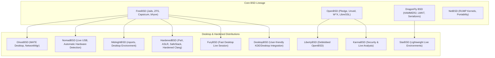

# BSD Extended Ecosystem Parity Specification

> **Principles:** ABSTRACTION · ARCHITECTURE · COMPONENT ISOLATION · DEFENSIVE PROGRAMMING · LEAST PRIVILEGE · SAFE CONCURRENCY · SEPARATION OF MECHANISM & POLICY · UNIFORM INFORMATION

This specification documents the architecture, kernel abstractions, and security mechanisms drawn from the full spectrum of the BSD family, establishing parity across SigmaOS subsystems.

---

## 1. BSD Ecosystem Taxonomy

SigmaOS synthesizes design choices from major BSD implementations and specialized downstream distributions:



---

## 2. Subsystem Synthesis Matrix

| Distro / Project | Core Innovation | SigmaOS Parity Engine | Architectural Principle |
| :--- | :--- | :--- | :--- |
| **GhostBSD** | Live session hardware detection, Fish-based desktop shell | `SigmaOS-live-session`, `SigmaOS-desktop` | USER FREEDOM AND CONTROL |
| **NomadBSD** | Automatic graphical configuration on boot, USB mobility | `SigmaOS-installer`, `SigmaOS-ISO` | PLUG-IN DRIVER MODEL |
| **MidnightBSD** | GNUstep integration, mports package management | `SigmaOS-packages-kit`, `SigmaOS-desktop-library` | CLEAR ABSTRACTION |
| **HardenedBSD** | Full-system ASLR, PaX NOEXEC, CFI (Control Flow Integrity) | `SigmaOS-security`, `SigmaOS-kernel` | SECURE DEFAULTS |
| **LibertyBSD** | 100% libre kernel without non-free firmware blobs | `SigmaOS-drivers`, `SigmaOS-kernel` | FREE AND OPEN SOURCE SOFTWARE |
| **FuryBSD** | Modular XFCE/KDE desktop overlay on FreeBSD | `SigmaOS-desktop-configuration` | COMPOSITION OVER INHERITANCE |
| **DesktopBSD** | Desktop privilege elevation, utility integration | `SigmaOS-control-center`, `SigmaOS-system-admin` | LEAST PRIVILEGE |
| **KarmaBSD** | Forensics & auditing sandbox | `SigmaOS-security`, `SigmaOS-dev-tools` | PROCESS ISOLATION |
| **StarBSD** | Resilient lightweight fallback shell | `SigmaOS-term`, `SigmaOS-fish` | KEEP IT SIMPLE STUPID |

---

## 3. Kernel Security & Isolation Primitives

### 3.1. Capability-Based Sandboxing (Capsicum & Pledge/Unveil)
SigmaOS combines OpenBSD's simple process-level syscall restriction with FreeBSD's capability rights:

```rust
pub struct CapabilityRights {
    pub read: bool,
    pub write: bool,
    pub seek: bool,
    pub mmap: bool,
    pub ioctl: bool,
    pub socket_ops: bool,
}

pub trait SecureSandbox {
    fn pledge(&mut self, promises: &[&str]) -> Result<(), SandboxError>;
    fn unveil(&mut self, path: &Path, permissions: &str) -> Result<(), SandboxError>;
    fn limit_fd(&mut self, fd: RawFd, rights: CapabilityRights) -> Result<(), SandboxError>;
}
```

### 3.2. Jails & Compartmentalization
Modeled on FreeBSD VNET jails and DragonFly BSD jail namespaces:
- Isolated networking stacks (virtualized loopback and routing tables)
- Per-jail user ID mappings (root inside jail != root on host)
- Read-only hierarchical filesystem mounts with copy-on-write scratch spaces

---

## 4. Filesystem Parity: HAMMER2 and OpenZFS
- **DragonFly HAMMER2:** Clustered copy-on-write, instant zero-cost snapshotting, directory deduplication.
- **OpenZFS:** ARC cache-conscious paging, native cryptographic dataset encryption, continuous data scrubbing.
- SigmaOS implements zero-copy buffer passing (`ZeroCopyBuffer`) between block devices and page cache.
