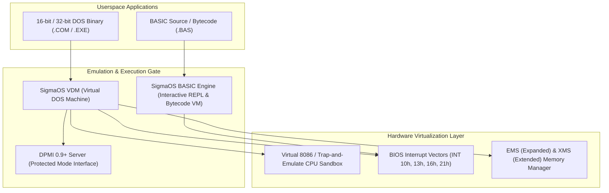

# DOS and Legacy Compatibility Specification

> **Principles:** ABSTRACTION · BLACKBOX · DIRECT DEVICE CONTROL · FAIL-FAST SYSTEM · GALL'S LAW · LOW LEVEL CONTROL · PRISTINE SOURCES · SEPARATION OF CONCERNS · WORSE IS BETTER

This document defines the SigmaOS subsystem architecture for retro-computing, real-mode execution, DOS emulation, and BASIC language runtime environments.

---

## 1. Architectural Overview

SigmaOS provides a clean-room, sandboxed subsystem for executing legacy 16-bit and 32-bit DOS applications and interpreted BASIC programs without exposing the host microkernel to real-mode hardware risks.



---

## 2. Platform Inspirations & Parity Mapping

| Platform | Architectural Inspiration | SigmaOS Implementation |
| :--- | :--- | :--- |
| **FreeDOS** | Open-source DOS kernel, FAT32 support, COMMAND.COM | `SigmaOS-term`, `SigmaOS-filesystem` FAT12/16/32 driver |
| **MS-DOS** | INT 21h DOS API, CONFIG.SYS / AUTOEXEC.BAT parsing, device drivers | Native INT 21h dispatcher with CP/M-compatible zero-page layout |
| **BASIC** | Microsoft BASIC / GW-BASIC / QBasic line-numbered & structured REPL | Built-in `#![no_std]` interactive interpreter and JIT compiler |
| **ReactOS NTVDM** | Windows NT Virtual DOS Machine architecture, VDDs (Virtual Device Drivers) | Userspace VDM container with Sound Blaster 16 and VESA BIOS extensions |

---

## 3. Interrupt Vector Virtualization

The DOS emulation gate traps CPU software interrupts and dispatches them to pure-Rust emulation handlers:

```rust
pub enum DosInterrupt {
    Int10hVideoService(VideoRegisters),
    Int13hDiskService(DiskRegisters),
    Int16hKeyboardService(KeyboardRegisters),
    Int21hDosApiService(DosRegisters),
    Int33hMouseService(MouseRegisters),
}

pub struct DosRegisters {
    pub ax: u16,
    pub bx: u16,
    pub cx: u16,
    pub dx: u16,
    pub si: u16,
    pub di: u16,
    pub bp: u16,
    pub flags: u16,
}

pub trait DosSubsystem {
    fn dispatch_syscall(&mut self, int_num: u8, regs: &mut DosRegisters) -> Result<(), &'static str>;
    fn allocate_conventional_memory(&mut self, paragraphs: u16) -> Option<u16>;
    fn free_conventional_memory(&mut self, segment: u16) -> bool;
}
```

---

## 4. BASIC Runtime Environment

The SigmaOS BASIC engine supports classic dialect commands and modern procedural constructs:
- **Core keywords:** `PRINT`, `INPUT`, `LET`, `GOTO`, `GOSUB`, `RETURN`, `FOR...NEXT`, `IF...THEN...ELSE`, `DIM`, `DATA`, `READ`
- **Graphics & Sound:** `SCREEN`, `PSET`, `LINE`, `CIRCLE`, `SOUND`, `PLAY`
- **Zero-allocation REPL:** Interactive execution within standard terminal emulators (`SigmaOS-term`).
