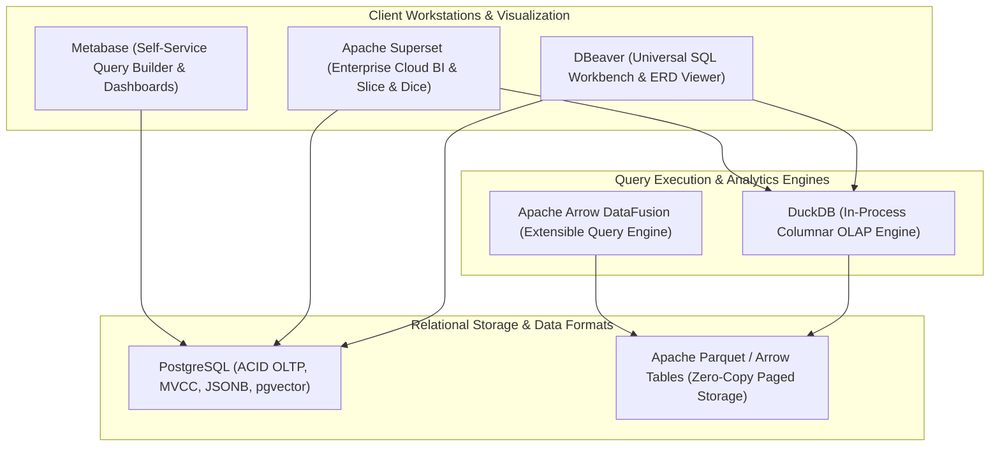

# Database and Data Engineering Architecture

> **Principles:** CACHE CONSCIOUS DESIGN · CLEAR ABSTRACTION · DETERMINISTIC TESTING · LOCALITY OF REFERENCE · MEMORY SAFETY · OPEN STANDARD AND INTEROPERABILITY · RACE-FREE DESIGN · SAFE CONCURRENCY · ZERO-COPY

This specification details the relational database, analytical columnar engine, SQL workbench, and business intelligence architectures integrated natively into SigmaOS.

---

## 1. Data Technology Stack

SigmaOS integrates a multi-tiered data engine for transactional (OLTP), analytical (OLAP), interactive exploration, and dashboard reporting workloads:



---

## 2. Component Role & Parity Matrix

| System / Tool | Core Architecture | Role in SigmaOS |
| :--- | :--- | :--- |
| **PostgreSQL** | Process-per-connection, WAL, MVCC, extensible types | System configuration catalog, secure credential store, application database |
| **DuckDB** | Thread-pool vectorized execution, columnar in-process | Instant desktop analytics, spreadsheet query engine, OS telemetry analysis |
| **DBeaver** | Eclipse RCP / Java-based universal database client | Graphical schema browser, query builder, and data migration assistant |
| **Apache Arrow / DataFusion** | Columnar in-memory format, SIMD vectorized execution | Zero-copy data exchange between OS microservices and AI models |
| **Apache Superset** | Python/Flask backend, React frontend, slicing & dicing | System diagnostic visualization and cluster observability dashboards |
| **Metabase** | Clojure/JVM zero-config analytical query visualizer | Native end-user business analytics and system performance explorer |

---

## 3. High-Performance Zero-Copy Data Pipelines

SigmaOS leverages memory-mapped Arrow buffers to eliminate serialization overhead across IPC boundaries:

```rust
pub struct ZeroCopyColumnBuffer {
    data_ptr: *const u8,
    len_bytes: usize,
    num_rows: usize,
    null_bitmap_offset: usize,
}

pub trait AnalyticalEngine {
    fn scan_parquet(&self, path: &Path) -> Result<ZeroCopyColumnBuffer, DbError>;
    fn execute_vector_query(&self, sql: &str) -> Result<ZeroCopyColumnBuffer, DbError>;
}
```

- **Vectorized Execution:** Processes batches of 1024 or 2048 values simultaneously using AVX2/AVX-512 SIMD instructions.
- **Embedded AI Embeddings:** Native `pgvector` and DuckDB HNSW vector index support for semantic search and local coding agent memory lookups.
