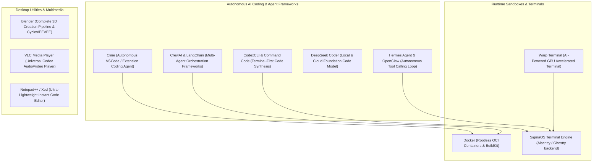

# Developer Tools and AI Agent Ecosystem

> **Principles:** AVOID FRAGMENTATION · BOY SCOUT RULE · CODE REUSABILITY · COLLABORATION & SHARED RESPONSIBILITY · COMMAND-QUERY SEPARATION · COMMUNITY-ORIENTED DEVELOPMENT · FAST-ISOLATED-REPEATABLE-SELF VALIDATING-TIMELY · INSTRUMENTATION · MERITOCRACY AND INCLUSIVITY · MODULARITY · POWER OF TEN · USER FREEDOM AND CONTROL

This specification establishes the execution environment, SDK bindings, and container runtimes for modern AI coding agents, terminals, IDEs, and 3D/multimedia creative tools within SigmaOS.

---

## 1. Tooling & Agent Taxonomy

---

## 2. Integrated Toolset Matrix

| Tool / Framework | Category | Role in SigmaOS | Key Feature |
| :--- | :--- | :--- | :--- |
| **Blender** | 3D Creation & VFX | 3D modeling, animation, rendering, and compositing | Native Vulkan / OptiX / Metal acceleration |
| **Cline** | Autonomous Coding Agent | In-editor multi-file refactoring and task execution | MCP (Model Context Protocol) tool integration |
| **CodexCLI & Command Code** | CLI Coding Agent | Command-line code generation and automated testing | Shell pipeline syntax interpretation |
| **CrewAI** | Multi-Agent Orchestration | Role-playing autonomous agent teams | Collaborative task delegation and shared state |
| **DeepSeek Coder** | LLM Code Engine | Specialized code intelligence and autocomplete | 128K context window, infilling capabilities |
| **Docker** | Containerization | Isolated application microservices and builds | Rootless container execution, cgroups v2 |
| **Hermes Agent** | Autonomous Agent Engine | Long-running task execution with self-correction | Function calling loops and session persistence |
| **LangChain** | Agent Abstraction Library | Connects LLMs with external tools and vector stores | Composable LCEL chains, retrieval-augmented gen |
| **Notepad++ / Xed** | Lightweight Editor | Instant file editing without IDE startup overhead | Scintilla text component, syntax coloring |
| **OpenClaw** | Autonomous Agent Gateway | Open-source agent runner and execution harness | Deterministic execution and verification |
| **VLC** | Multimedia Player | Universal format playback and media streaming | Zero external codec dependencies |
| **Warp** | AI Terminal | Collaborative, block-based terminal workstation | Command history search, workflow workflows |

---

## 3. Sandboxed Agent Execution Environment

To guarantee **LEAST PRIVILEGE** and **FAIL-FAST** execution, AI agents running inside SigmaOS operate within restricted namespaces:
- **Filesystem Unveil:** Agents only possess read/write access to the specific project directory workspace.
- **Network Gate:** Outgoing network traffic is filtered through domain allowlists (`SigmaOS-domain-blocker`).
- **Deterministic Testing Loop:** Agents run tests inside ephemeral scratch overlays using Arrange-Act-Assert methodologies before submitting commits.
