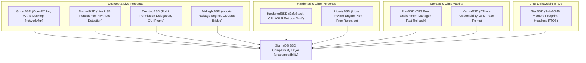

# Extended BSD Ecosystem Parity Specification

> **Principles:** ABSTRACTION · ARCHITECTURE · DEFENSIVE PROGRAMMING · LEAST PRIVILEGE · MODULARITY · OPEN STANDARD AND INTEROPERABILITY · PROCESS ISOLATION · SECURE DEFAULTS · ZERO-COPY

This specification details the architecture, emulation layers, security profiles, and binary compatibility interfaces for 9 specialized BSD distributions integrated into **SigmaOS**.

---

## 1. Distribution Ecosystem Matrix

SigmaOS provides fine-grained binary, driver, and persona compatibility for the full spectrum of BSD operating systems:

---

## 2. Technical Architectural Components

### 2.1 GhostBSD (`ghost_bsd.rs`)
- **Init System:** OpenRC service manager compatibility (`OpenRcService` with `start`, `stop`, `restart`, `status`).
- **Desktop Environments:** Native integration for MATE, Xfce, and Budgie sessions.
- **Networking:** NetworkManager userland bridge supporting dynamic wireless configuration and VPN profiles.

### 2.2 NomadBSD (`nomad_bsd.rs`)
- **Persistence Architecture:** Layered memory/disk persistence (`Volatile`, `Overlay`, `Full`).
- **Hardware Autodetection:** Dynamic PCI/USB probing for graphics acceleration (NVIDIA/Intel/AMD) and WiFi chipset firmware.
- **Portability:** Fast state import/export across volatile live-boot media.

### 2.3 MidnightBSD (`midnight_bsd.rs`)
- **Package Management:** `mports` package resolver, dependency solver, and binary indexing engine.
- **Application Framework:** GNUstep workspace bridge, OpenStep/Cocoa API translation stubs, and defaults system.

### 2.4 HardenedBSD (`hardened_bsd.rs`)
- **SafeStack:** Independent stack separation for return addresses and local buffer variables.
- **Control Flow Integrity (CFI):** Forward-edge and backward-edge CFI validation for indirect calls and jump tables.
- **ASLR Entropy:** 32-bit and 64-bit entropy maximization across stack, heap, and mmap allocations.
- **W^X Enforcement:** Strict page-table attribute validation preventing concurrent write and execute permissions.

### 2.5 LibertyBSD (`liberty_bsd.rs`)
- **Blob Audit Engine:** Cryptographic verification (SHA-256) of device drivers and firmware.
- **Libre Policy:** Automated rejection of proprietary microcode blobs and unverified binary shims.
- **Hardware Whitelist:** Strict runtime checking guaranteeing 100% Free and Open Source software (FOSS) compliance.

### 2.6 FuryBSD (`fury_bsd.rs`)
- **ZFS Boot Environments:** Rapid snapshot, clone, and rollback lifecycle for OS root datasets.
- **BeManager:** `beadm` and `bectl` command parity for creating, activating, and destroying boot environments.
- **Atomic Upgrades:** Non-disruptive kernel/userland upgrades into inactive boot environments with reboot verification.

### 2.7 DesktopBSD (`desktop_bsd.rs`)
- **Permission Delegation:** Fine-grained Polkit-compatible role authorization (`PermissionDelegate`).
- **Package GUI:** High-level graphical bridge for FreeBSD `pkg` and port installations.
- **Hardware Configuration:** Desktop-friendly disk mounter, sound device selector, and printer discovery.

### 2.8 KarmaBSD (`karma_bsd.rs`)
- **DTrace Instrumentation:** Dynamic probe point provider (`DTraceProbe`, `ProbePoint`).
- **ZFS Metrics:** High-resolution latency histograms, ARC cache hit/miss statistics, and I/O vdev counters.
- **Real-Time Profiling:** Kernel-level CPU sampling, syscall latency tracking, and thread lock contention inspection.

### 2.9 StarBSD (`star_bsd.rs`)
- **Memory Footprint:** Guaranteed sub-10MB total memory consumption during headless operation.
- **RTOS Scheduling:** Fixed-priority preemptive scheduling (`StarRtosKernel`, `TaskPriority`).
- **Memory Guard:** `MemFootprintGuard` allocation tracking with zero memory fragmentation and static buffer pools.

---

## 3. Implementation and Verification

All 9 BSD target compatibility modules are located in `src/compatibility/` within the SigmaOS repository and exported via `src/compatibility/mod.rs`.
Unit tests validate contract adherence, memory budgets, and security properties.
