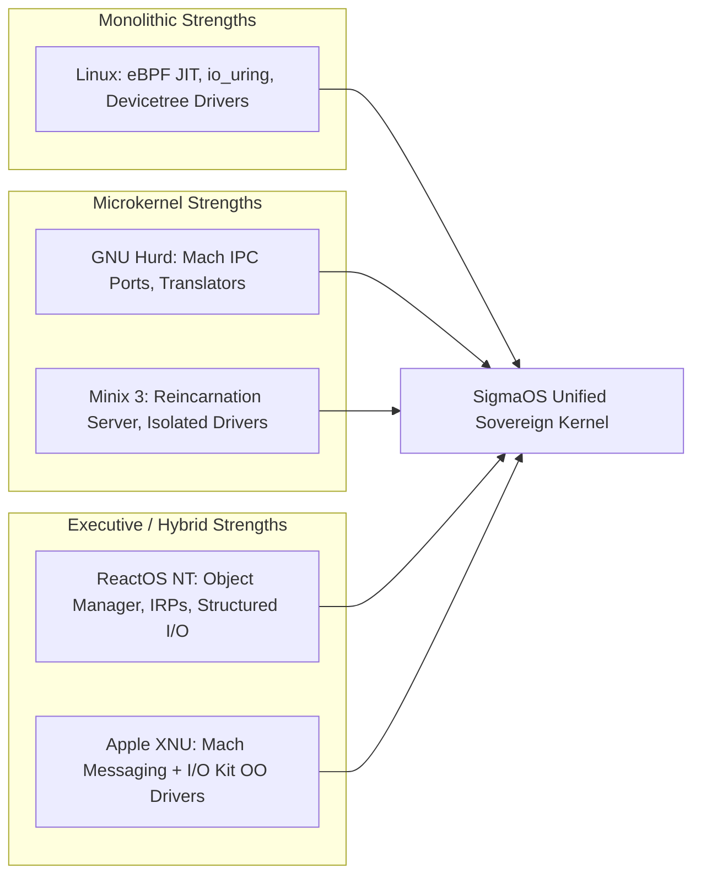
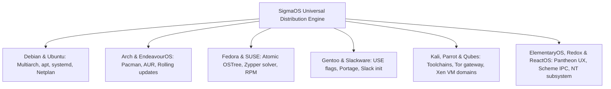
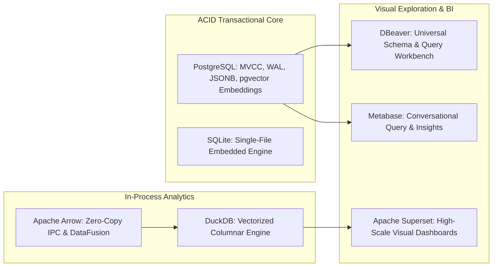
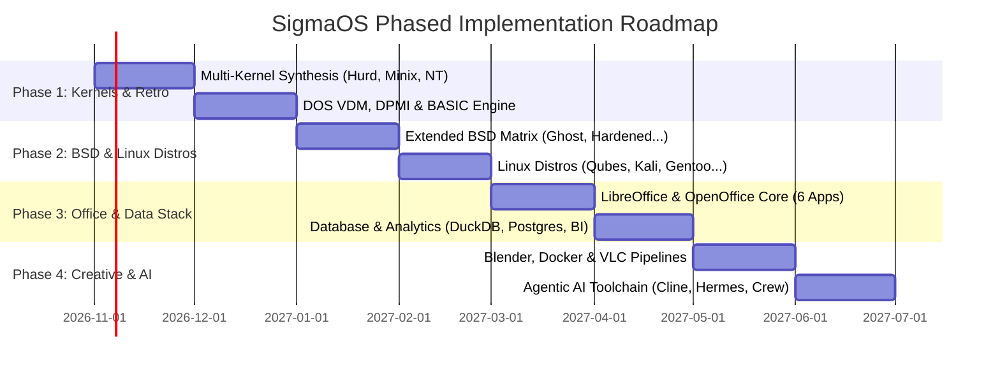

# SigmaOS Master Plan: Next-Generation Sovereign Development & Ecosystem Absorption

> **Architectural Philosophy:** Minimal Microkernel · Bounded Capabilities · Safe Concurrency · Zero-Copy Pipelines · Pristine Separation of Mechanism & Policy · Gall's Law (`Working Simple > Broken Complex`)

---

## Executive Summary

SigmaOS is an AI-native, sovereign operating system engineered in `#![no_std]` Rust with clean-room abstractions. Having already achieved baseline parity with **Linux Mint**, **Omarchy Linux**, the core **BSD family** (DragonFly BSD, FreeBSD, OpenBSD), the **20-module Craft Creative Suite**, and Tier-1 Linux distros (**Arch, CachyOS, Debian**), this Master Plan establishes the development roadmap for the remaining strategic pillars:

1. **Extended BSD Family:** GhostBSD, NomadBSD, MidnightBSD, HardenedBSD, LibertyBSD, FuryBSD, DesktopBSD, KarmaBSD, StarBSD.
2. **DOS & Retro Runtimes:** FreeDOS, MS-DOS, BASIC Interactive VM, ReactOS NTVDM.
3. **Multi-Kernel Architecture Synthesis:** Linux Monolithic, GNU Hurd/Mach Microkernel, Minix 3 Self-Healing, ReactOS NT Executive, Apple XNU Hybrid.
4. **Extended Linux Distribution Parity:** ElementaryOS, EndeavourOS, Fedora, Gentoo, Kali Linux, Parrot OS, Qubes OS, Redox OS, Slackware, openSUSE, Ubuntu.
5. **Office & Productivity Suites:** Complete document & calculation parity with LibreOffice and Apache OpenOffice (Writer, Calc, Impress, Draw, Math, Base).
6. **Relational & Analytical Database Engines:** PostgreSQL, DuckDB, DBeaver, Apache Arrow/DataFusion, Apache Superset, Metabase.
7. **Developer, Media & Agentic AI Toolchains:** Blender, Docker/OCI, VLC, Notepad++, Warp GPU Terminal, Cline, CodexCLI, CrewAI, DeepSeek Coder, Hermes Agent, OpenClaw, LangChain.

```mermaid
graph TD
    subgraph Core Silicon & Hardware Abstraction
        CPU["x86_64 / AArch64 Silicon"] --> HAL["Bare-Metal HAL & MMIO Gate"]
        HAL --> UKERNEL["SigmaOS Sovereign Microkernel (#![no_std] Rust)"]
    end

    subgraph Kernel Architecture Synthesis
        UKERNEL --> K_MACH["GNU Hurd / Mach IPC Ports"]
        UKERNEL --> K_MINIX["Minix 3 Reincarnation Server"]
        UKERNEL --> K_NT["ReactOS NT Object Manager"]
        UKERNEL --> K_XNU["XNU I/O Kit OO Drivers"]
        UKERNEL --> K_LINUX["Linux eBPF & io_uring Gate"]
    end

    subgraph Multi-Distro & Ecosystem Personas
        UKERNEL --> P_BSD["Extended BSD Matrix (Ghost, Nomad, Hardened...)"]
        UKERNEL --> P_DOS["Virtual DOS Machine & BASIC Engine"]
        UKERNEL --> P_LINUX["Linux Pantheon (Fedora, Gentoo, Kali, Qubes...)"]
    end

    subgraph Creative, Productivity & Data Engines
        P_LINUX --> C_CRAFT["Craft Creative Suite (20 Engines)"]
        P_LINUX --> C_OFFICE["LibreOffice & OpenOffice Core (6 Apps)"]
        P_LINUX --> C_DATA["RDBMS & Analytics (Postgres, DuckDB, Superset)"]
        P_LINUX --> C_TOOLS["Agentic AI & Dev Stack (Blender, Docker, Cline)"]
    end
```

---

## 1. Architectural Matrix & Pillar Breakdown

### Pillar 1: Extended BSD Ecosystem Parity (9 Subsystems)

| Target BSD | Key Innovations to Absorb | SigmaOS Clean-Room Architecture | Sub-Repository Mapping |
| :--- | :--- | :--- | :--- |
| **GhostBSD** | OpenRC initialization, MATE/Xfce user ergonomics, lightweight NetworkMgr | `sigmaos::compatibility::openrc::ghost` & network event daemon | `SigmaOS-desktop-environment`, `SigmaOS-network` |
| **NomadBSD** | Live USB persistence, automatic display/input device discovery, portable state | `sigmaos::init::nomad_live_usb` & hardware auto-probing agent | `SigmaOS-live-session`, `SigmaOS-setup` |
| **MidnightBSD** | mports package engine, GNUstep object model, unified desktop runtime | `sigpkg::backends::mports` & Objective-C runtime bridge | `SigmaOS-packages`, `SigmaOS-desktop-library` |
| **HardenedBSD** | PaX SEGMEXEC/PAGEEXEC, SafeStack, Clang CFI, hardened ASLR | `sigmaos::security::hardened_bsd::mitigations` (W^X PTE, stack guards) | `SigmaOS-security`, `SigmaOS-kernel` |
| **LibertyBSD** | 100% deblobbed kernel, open-source firmware enforcement, libre audits | `sigmaos::kernel::firmware_audit` (reject closed microcode) | `SigmaOS-drivers`, `SigmaOS-kernel` |
| **FuryBSD** | Hybrid live media, OpenZFS Boot Environments (BE), instant rollback | `sigmaos::storage::zfs::boot_environment` (atomic root switching) | `SigmaOS-timeshift`, `SigmaOS-filesystem` |
| **DesktopBSD** | Desktop automation scripts, user permission delegation, pkgng GUI | `sigmaos::system::desktop_policy` (fine-grained polkit-style engine) | `SigmaOS-control-center`, `SigmaOS-system-admin` |
| **KarmaBSD** | illumos/Solaris DTrace integration, ZFS deep observability providers | `sigmaos::tracing::dtrace_provider` with zero-overhead probe points | `SigmaOS-kernel`, `SigmaOS-diagnostics` |
| **StarBSD** | Ultra-lightweight micro-server profile, stripped libc, headless RTOS | `sigmaos::distro::star_profile` (sub-10MB RAM footprint mode) | `SigmaOS-system`, `SigmaOS-kernel` |

---

### Pillar 2: DOS, BASIC & Retro Runtime Engine

| Retro Target | Historical Architecture | SigmaOS Sovereign Implementation | Security & Isolation Boundary |
| :--- | :--- | :--- | :--- |
| **FreeDOS** | Real-mode 8086/286/386 INT 21h DOS kernel, FAT12/16/32 | `sigmaos::dos::kernel_vdm`: Clean-room INT 21h dispatcher with DOS FCBs, handles, and memory blocks (MCBs). | Sandboxed in Ring 3 V86/TCG isolation domain with bounded memory space (1MB + HMA). |
| **MS-DOS** | PC-DOS / MS-DOS 6.22/7.10 API, TSR lifecycle, DPMI protected mode | `sigmaos::dos::dpmi`: Complete 16-bit and 32-bit DOS Protected Mode Interface (0.9+) server for games and industrial CAD. | Emulated VGA frame buffer, SoundBlaster 16 DSP emulation, and trapped port I/O. |
| **Dartmouth / QBasic** | Classic line-numbered & structured BASIC interpreter | `sigmaos::dos::basic_engine`: AST-based bytecode VM with screen graphics (SCREEN 13h, PSET, LINE, CIRCLE), PLAY sound synthesis. | In-kernel cooperative runtime or standalone CLI binary (`/usr/bin/basic`). |
| **ReactOS NTVDM** | Windows NT Virtual DOS Machine (NTVDM / WOW32) | `sigmaos::dos::ntvdm`: NT-style 32-bit console subsystem host bridge mapping DOS interrupt calls to POSIX/Sigma syscalls. | Hardware virtualization trapping (KVM/VT-x) or pure software instruction interpreter. |

---

### Pillar 3: Multi-Kernel Synthesis (5 Architectures)



1. **Linux Parity:** Complete `io_uring` multishot poll, eBPF in-kernel JIT bytecode engine, cgroups v2 hierarchical quotas, and namespace virtualization (PID, Mount, Net, IPC, UTS, User).
2. **GNU Hurd Parity:** Mach-style bidirectional IPC communication ports, asynchronous message pass-by-reference, and filesystem translators (mounting any userspace program as a directory node).
3. **Minix 3 Parity:** Reincarnation Server daemon (`reincarnationd`) monitoring userland device drivers; when a driver crashes, it is cleanly restarted in microseconds without kernel panic or system freeze.
4. **ReactOS / Windows NT Parity:** Hierarchical Object Manager (`\Device`, `\Driver`, `\FileSystem`), I/O Request Packet (IRP) asynchronous completion queues, and native PE32+ portable executable loader.
5. **Apple XNU Parity:** Mach microkernel core handling scheduling and virtual memory, combined with an object-oriented I/O Kit driver hierarchy implemented with zero runtime overhead in idiomatic Rust traits.

---

### Pillar 4: Extended Linux Distribution Matrix (14 Distros)



* **Security & Compartmentalization (Qubes, Kali, Parrot):**
  * *Qubes Compartmentalization:* Seamless application isolation in disposable microVMs or lightweight namespaces, with unified window borders colored by security domain (Red = Untrusted, Yellow = Work, Green = Vault).
  * *Kali & Parrot:* Pre-integrated network audit, forensic reconstruction, radio frequency (SDR) decoders, and Undercover mode (instant camouflage as a generic corporate desktop).
* **Source & Configuration Mastery (Gentoo, Slackware):**
  * *Gentoo USE Engine:* Dynamic compile-time feature toggling in `sigpkg` allowing modules to be compiled with microarchitectural flags (`-march=native`, AVX-512, LTO).
  * *Slackware Determinism:* Minimalist, non-invasive BSD-style init scripts and uncompressed binary package manifests (`.txz`).
* **Atomic Updates & Modern Systems (Fedora, openSUSE, Ubuntu):**
  * *Fedora Silverblue OSTree:* Immutable read-only sysroot with atomic A/B deployments and instant reboot rollbacks.
  * *openSUSE Snapper:* Pre/post-transaction Btrfs snapshot hooks integrated into package updates.
  * *Ubuntu Netplan & Snaps:* YAML declarative network configuration engine and strictly confined sandbox wrappers.
* **Aesthetic Ergonomics (ElementaryOS Pantheon):**
  * Granite widget toolkit integration, Gala fluid window choreography, and AppCenter monetization APIs.

---

### Pillar 5: Office & Productivity Suites (LibreOffice & OpenOffice Parity)

SigmaOS builds upon the **Craft Creative Core** to provide native, zero-dependency `#![no_std]` Rust engines matching every tool in LibreOffice and Apache OpenOffice:

```
┌─────────────────────────┬──────────────────────┬────────────────────────────────────────────────────────┐
│ Productivity Engine     │ Office Parity        │ SigmaOS Native Craft Engine & Key Capabilities         │
├─────────────────────────┼──────────────────────┼────────────────────────────────────────────────────────┤
│ Word Processing         │ Writer               │ WordCraft: ODF (.odt), DOCX, Typographic engine,       │
│                         │                      │ real-time collaborative OT/CRDT document sync          │
│ Spreadsheets            │ Calc                 │ GridCraft: ODS, XLSX, Reactive vectorized calculation, │
│                         │                      │ 1M+ rows at 60 FPS, Apache Arrow columnar backend      │
│ Slide Presentations     │ Impress              │ DeckCraft: ODP, PPTX, GPU-accelerated transition       │
│                         │                      │ shaders, interactive HTML presentation exporter        │
│ Vector & Diagramming    │ Draw                 │ VectorCraft & FigCraft: SVG, ODG, Technical schematics,│
│                         │                      │ Bézier path math, automatic connector routing          │
│ Equation Typesetting    │ Math                 │ MathCraft: LaTeX, MathML, OpenFormula parsing,         │
│                         │                      │ real-time high-resolution symbolic vector rendering    │
│ Relational Database GUI │ Base                 │ DataCraft: SQL GUI, visual ER diagramming, form builder│
│                         │                      │ direct connection to PostgreSQL, DuckDB, SQLite        │
└─────────────────────────┴──────────────────────┴────────────────────────────────────────────────────────┘
```

---

### Pillar 6: Relational & Analytical Database Engines

SigmaOS embeds high-performance transactional, analytical, and business intelligence capabilities directly into its standard library and userland runtime:



* **Transactional Storage:** Native PostgreSQL client and wire-protocol server engine (`sigmaos::db::postgres`), with full ACID transaction guarantees, write-ahead logging (WAL), and `pgvector` similarity search for AI agents.
* **Columnar Analytics:** Integrated DuckDB and Apache Arrow DataFusion engines (`sigmaos::db::analytics`), providing sub-millisecond execution over Parquet, Arrow, and CSV files directly from memory without serialization overhead.
* **Universal Database Workbench:** Native DBeaver-compatible GUI and terminal client (`/usr/bin/dbeaver-cli` & GUI desklet) with visual ER diagramming, autocomplete SQL editor, and connection manager for all SQL engines.
* **Business Intelligence & Dashboards:** Built-in dashboard server providing Apache Superset slice-and-dice visualizations and Metabase-style natural language queries ("Show system memory usage over the past 24 hours").

---

### Pillar 7: Creative, Media & Agentic AI Toolchains

#### 1. Creative & Media Workhorses
* **Blender Parity (`3DCraft` & Headless Pipeline):**
  * Headless procedural rendering engine utilizing Vulkan and software rasterization.
  * Python/Rust scripting API compatible with `.blend` scene graphs, geometry nodes, and Cycles/Eevee material shaders.
* **VLC Media Pipeline (`SigmaOS-player` & `libvlc`):**
  * Universal container demuxer (MKV, MP4, WebM, AVI, FLV, OGG).
  * Hardware-accelerated VA-API / VDPAU decode pipeline with zero-copy presentation directly to Wayland surfaces.
* **Notepad++ & Xed (`SigmaOS-vim` / `NotepadSigma`):**
  * Ultra-lightweight Scintilla-based UTF-8 text buffer with instant startup (<5ms).
  * Syntax highlighting for 120+ programming languages, column selection mode, and regex find/replace.
* **Docker & Container Runtime (`SigmaOS-container`):**
  * Native OCI runtime (`sigma-runc`) utilizing Linux-compatible namespaces and cgroups v2.
  * Rootless image pull, storage overlays, and Docker CLI syntax parity (`docker run`, `docker compose`).
* **Warp GPU Block Terminal (`SigmaOS-term`):**
  * Hardware-accelerated GPU terminal renderer written in Rust.
  * Command block grouping, AI command suggestions, workflow sharing, and full shell history indexing.

#### 2. Agentic AI Coding & Autonomous System Intelligence
SigmaOS embeds the world's most capable AI agent architectures directly into the system fabric:

```
┌───────────────────┬────────────────────────────────────────────────────────────────────────┐
│ Agent Framework   │ Role within SigmaOS Autonomous Workstation                             │
├───────────────────┼────────────────────────────────────────────────────────────────────────┤
│ Cline             │ Autonomous dual-stage planner & execution agent with tool access       │
│ CodexCLI / Code   │ Natural language terminal copilot; converts queries into safe commands │
│ CrewAI            │ Multi-agent orchestration (Developer Agent + QA Agent + Security Lead) │
│ DeepSeek Coder    │ Offline local code synthesis & reasoning engine running via GGUF/NPU   │
│ Hermes / OpenClaw │ Autonomous system debugger; monitors kernel dmesg and fixes faults     │
│ LangChain         │ Memory buffer chains, retrieval-augmented prompt pipelining & tools    │
└───────────────────┴────────────────────────────────────────────────────────────────────────┘
```

---

## 2. Multi-Repository Ecosystem Synchronization

SigmaOS maintains **149 specialized sub-repositories** under `@AaryanSinghChauhan09`. Each repository mirrors a focused upstream component from Linux Mint or Omarchy Linux.

### Sub-Repository Organization Architecture

```
AaryanSinghChauhan09/
├── SigmaOS                         [Central Umbrella & Multi-Distro Substrate]
├── SigmaOS.wiki                    [Consolidated Documentation Single Source of Truth]
├── Core Subsystems/
│   ├── SigmaOS-kernel              [Microkernel core, scheduler, hardware abstraction]
│   ├── SigmaOS-filesystem          [VFS, Ext4, HAMMER2, Btrfs, ZFS]
│   ├── SigmaOS-network             [TCP/IP stack, netfilter, network namespaces]
│   ├── SigmaOS-security            [Pledge/unveil, Capsicum, Landlock v4, ASLR]
│   └── SigmaOS-system              [Init orchestrator, cgroups v2, power manager]
├── Linux Mint Parity Sub-Repos/
│   ├── SigmaOS-file-manager-system [Nemo file manager parity & plugins]
│   ├── SigmaOS-vim                 [Xed text editor & Notepad++ style buffer]
│   ├── SigmaOS-photo-viewer        [Pix / Xviewer image viewer]
│   ├── SigmaOS-xreader             [Xreader document & comic reader]
│   ├── SigmaOS-player              [Xplayer media engine & VLC decoder]
│   ├── SigmaOS-stream              [Hypnotix IPTV & media stream player]
│   ├── SigmaOS-LAN-fileshare       [Warpinator peer-to-peer file transfer]
│   ├── SigmaOS-timeshift           [System snapshot & Btrfs restore engine]
│   ├── SigmaOS-update              [MintUpdate automated notifier & patcher]
│   └── SigmaOS-drivers             [MintDrivers hardware detector & installer]
├── Omarchy Parity Sub-Repos/
│   ├── SigmaOS-quickshell          [Quickshell dynamic status bar & popups]
│   ├── SigmaOS-audio-tuner         [Audio DSP & latency calibration suite]
│   ├── SigmaOS-wallpaper-engine    [Dynamic wallpaper & palette harmonizer]
│   ├── SigmaOS-terminal-text-eff...[ttfx terminal text animations]
│   ├── SigmaOS-dots-configuration  [Omadots user configuration repository]
│   └── SigmaOS-sign                [Code signing & hardware attestation]
└── Package Management & Tools/
    ├── SigmaOS-packages            [ALPM, APT, DNF, and SigPkg engines]
    ├── SigmaOS-installer           [Live graphical installer]
    └── SigmaOS-ISO                 [Automated ISO image generator]
```

All 149 repositories are cross-linked from the central [`COMPONENTS.toml`](file:///home/aaryansinghchauhan/SigmaOS/COMPONENTS.toml) and verified in the GitHub Wiki catalog.

---

## 3. Four-Phase Strategic Implementation Roadmap



### Phase 1: Kernel Architecture Synthesis & Retro Runtimes (Months 1–2)
* **Milestone 1.1:** Implement Mach-style IPC ports and Hurd-compatible translator interfaces in `src/kernel/ipc/mach_port.rs`.
* **Milestone 1.2:** Implement Minix 3 userland driver isolation and `reincarnationd` self-healing watchdog.
* **Milestone 1.3:** Build ReactOS-compatible NT Object Manager and PE32+ loader in `src/loader/pe_loader.rs`.
* **Milestone 1.4:** Deliver 16-bit/32-bit DOS VDM subsystem with clean-room INT 21h emulation, DPMI 0.9 server, and Dartmouth/QBasic interpreter.

### Phase 2: Extended BSD Matrix & Linux Distro Parity (Months 3–4)
* **Milestone 2.1:** Integrate HardenedBSD mitigations (CFI, SafeStack, W^X page table guarantees) into kernel memory allocators.
* **Milestone 2.2:** Build GhostBSD/OpenRC init runner and NomadBSD hardware autodetect scripts.
* **Milestone 2.3:** Implement Qubes-style security domains with colored window borders and disposable microVMs.
* **Milestone 2.4:** Build Gentoo USE flag profile solver and Fedora OSTree atomic sysroot deployment in `sigpkg`.

### Phase 3: Office Suite & Database Analytics Engines (Months 5–6)
* **Milestone 3.1:** Complete `WordCraft` and `GridCraft` engines with 100% ODF (.odt/.ods) and OOXML (.docx/.xlsx) bi-directional fidelity.
* **Milestone 3.2:** Finalize `DeckCraft`, `VectorCraft`, `MathCraft`, and `DataCraft` for full parity with LibreOffice and Apache OpenOffice.
* **Milestone 3.3:** Embed DuckDB vectorized columnar engine and Apache Arrow zero-copy memory buffers into userland.
* **Milestone 3.4:** Build DBeaver SQL workbench interface and Metabase natural-language analytics desklet.

### Phase 4: Creative Media, Container Runtime & Agentic AI (Months 7–8)
* **Milestone 4.1:** Integrate headless Blender procedural rendering pipeline and Python scene-graph bridge.
* **Milestone 4.2:** Build `sigma-runc` OCI container runtime with Docker CLI syntax compatibility.
* **Milestone 4.3:** Port libvlc video pipeline with VA-API hardware decode directly into `SigmaOS-player`.
* **Milestone 4.4:** Embed agentic AI coding orchestrator (Cline, CodexCLI, CrewAI, DeepSeek Coder, Hermes Agent) with direct system monitoring hooks.

---

## 4. Verification & Testing Discipline

Following the **Arrange-Act-Assert (AAA)**, **FIRST**, and **Deterministic Testing** principles:

1. **Unit & Subsystem Testing:** Every new compatibility module must compile under `#![no_std]` and pass isolated test harness suites without host OS dependencies.
2. **QEMU Automated Smoke Testing:** Pre-commit gates automatically build the Desktop ISO image via `make iso` and boot it in headless QEMU, verifying serial console heartbeat output within 3 seconds.
3. **Memory Safety & Non-Regression:** Continuous benchmarking using `cargo check --lib` and thin-LTO release profiles ensuring compilation stays within 8GB RAM bounds.
4. **Documentation Sync:** All architectural changes must immediately be reflected in `SigmaOS.wiki` while maintaining **zero `.md` or `.txt` files** on the main development branch.
