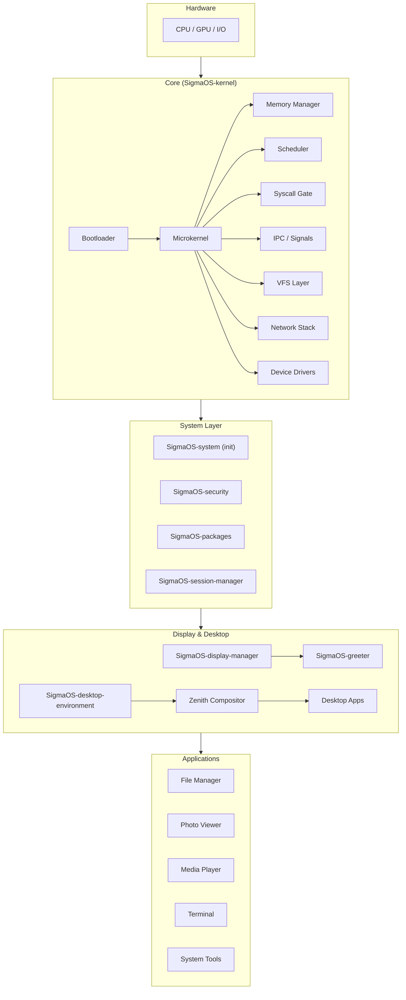

# SigmaOS Wiki

> **Uniform Information principle**: This wiki is the single source of truth. Every section mirrors the corresponding component repository's README. When the repo changes, this page changes too.

Welcome to the **SigmaOS** knowledge base — architecture, engineering plans, component catalog, and contributor guides all in one place.

---

## 1. What is SigmaOS?

**SigmaOS** is a modular, sovereign operating system built from first principles, inspired by the polish of **Linux Mint** and the opinionated simplicity of **Omarchy Linux**. It is written primarily in **Rust** (`#![no_std]` where possible) with selective C/C++ for hardware-critical paths.

| Property | Value |
| :--- | :--- |
| **Architecture** | Modular monorepo umbrella + 164 component repositories |
| **Kernel base** | Custom microkernel with POSIX-compatible syscall gate |
| **Display server** | Wayland (Zenith compositor) |
| **Package format** | Native `.sigma` packages; apt-compatible backend |
| **Init system** | SigmaOS-system (systemd-compatible) |
| **Primary language** | Rust (`no_std` / `alloc`); Python for tooling |
| **Inspirations** | Linux Mint, Omarchy, FreeBSD, OpenBSD, DragonFlyBSD |
| **License** | GPLv2 (kernel); MIT/Apache-2.0 (userland) |

---

## 2. Architecture Overview



---

## 3. Component Repositories

**Total: 164 repositories** across 13 categories.

### 🔵 Core

| Repository | Description |
| :--- | :--- |
| [`SigmaOS-kernel`](https://github.com/AaryanSinghChauhan09/SigmaOS-kernel) | Microkernel core — scheduler, VFS, syscall gate, memory |
| [`SigmaOS-filesystem`](https://github.com/AaryanSinghChauhan09/SigmaOS-filesystem) | Virtual filesystem layer, journaling & zero-copy paths |
| [`SigmaOS-network`](https://github.com/AaryanSinghChauhan09/SigmaOS-network) | Networking stack: TCP/IP, TLS, mDNS discovery |
| [`SigmaOS-security`](https://github.com/AaryanSinghChauhan09/SigmaOS-security) | Privilege separation, LSM hooks, secure defaults |
| [`SigmaOS-system`](https://github.com/AaryanSinghChauhan09/SigmaOS-system) | Init, service manager & system orchestration |
| [`SigmaOS-desktop`](https://github.com/AaryanSinghChauhan09/SigmaOS-desktop) | Wayland compositor shell & desktop primitives |
| [`SigmaOS-packages`](https://github.com/AaryanSinghChauhan09/SigmaOS-packages) | Package manager core (resolve, install, verify) |
| [`SigmaOS-bootloader`](https://github.com/AaryanSinghChauhan09/SigmaOS-bootloader) | Bootloader configuration & chainload manager |

### 🖥️ Display

| Repository | Description |
| :--- | :--- |
| [`SigmaOS-desktop-environment`](https://github.com/AaryanSinghChauhan09/SigmaOS-desktop-environment) | Cinnamon/Zenith desktop environment shell |
| [`SigmaOS-desktop-library`](https://github.com/AaryanSinghChauhan09/SigmaOS-desktop-library) | Shared desktop UI widget library |
| [`SigmaOS-desktop-portal`](https://github.com/AaryanSinghChauhan09/SigmaOS-desktop-portal) | XDG desktop portal backend |
| [`SigmaOS-desktop-configuration`](https://github.com/AaryanSinghChauhan09/SigmaOS-desktop-configuration) | Desktop session & settings persistence |
| [`SigmaOS-display-manager`](https://github.com/AaryanSinghChauhan09/SigmaOS-display-manager) | Display manager & login greeter launcher |
| [`SigmaOS-greeter`](https://github.com/AaryanSinghChauhan09/SigmaOS-greeter) | Slick login greeter with user list & a11y |
| [`SigmaOS-plymouth`](https://github.com/AaryanSinghChauhan09/SigmaOS-plymouth) | Boot splash / plymouth theme manager |
| [`SigmaOS-session-manager`](https://github.com/AaryanSinghChauhan09/SigmaOS-session-manager) | XDG session manager (start/stop/save sessions) |

### 📱 Desktop Apps

| Repository | Description |
| :--- | :--- |
| [`SigmaOS-file-manager`](https://github.com/AaryanSinghChauhan09/SigmaOS-file-manager) | Nemo-based file manager |
| [`SigmaOS-photo-viewer`](https://github.com/AaryanSinghChauhan09/SigmaOS-photo-viewer) | Image viewer with fullscreen & EXIF |
| [`SigmaOS-player`](https://github.com/AaryanSinghChauhan09/SigmaOS-player) | Video player (mpv-backed) |
| [`SigmaOS-draw2`](https://github.com/AaryanSinghChauhan09/SigmaOS-draw2) | Vector drawing app |
| [`SigmaOS-vim`](https://github.com/AaryanSinghChauhan09/SigmaOS-vim) | Vim editor integration |
| [`SigmaOS-nvim`](https://github.com/AaryanSinghChauhan09/SigmaOS-nvim) | Neovim integration & config |
| [`SigmaOS-term`](https://github.com/AaryanSinghChauhan09/SigmaOS-term) | Terminal emulator |
| [`SigmaOS-calc`](https://github.com/AaryanSinghChauhan09/SigmaOS-calc) | Calculator app |
| [`SigmaOS-sticky-notes`](https://github.com/AaryanSinghChauhan09/SigmaOS-sticky-notes) | Sticky notes / memo widget |
| [`SigmaOS-screen-shot`](https://github.com/AaryanSinghChauhan09/SigmaOS-screen-shot) | Screenshot tool (area, window, full) |
| [`SigmaOS-text-editor`](https://github.com/AaryanSinghChauhan09/SigmaOS-text-editor) | Xed / GTK text editor |
| [`SigmaOS-xreader`](https://github.com/AaryanSinghChauhan09/SigmaOS-xreader) | Document / eBook & comic reader |

### 🔧 System Tools

| Repository | Description |
| :--- | :--- |
| [`SigmaOS-installer`](https://github.com/AaryanSinghChauhan09/SigmaOS-installer) | Graphical live installer |
| [`SigmaOS-ISO`](https://github.com/AaryanSinghChauhan09/SigmaOS-ISO) | Build the SigmaOS live ISO |
| [`SigmaOS-software-manager`](https://github.com/AaryanSinghChauhan09/SigmaOS-software-manager) | GUI/CLI software store |
| [`SigmaOS-update`](https://github.com/AaryanSinghChauhan09/SigmaOS-update) | Update notifier & apply |
| [`SigmaOS-upgrade`](https://github.com/AaryanSinghChauhan09/SigmaOS-upgrade) | Major-release upgrade assistant |
| [`SigmaOS-timeshift`](https://github.com/AaryanSinghChauhan09/SigmaOS-timeshift) | Btrfs/rsync system snapshots & restore |
| [`SigmaOS-backup-tool`](https://github.com/AaryanSinghChauhan09/SigmaOS-backup-tool) | Backup / restore with manifest & verification |
| [`SigmaOS-drivers`](https://github.com/AaryanSinghChauhan09/SigmaOS-drivers) | Hardware driver collection & packaging |
| [`SigmaOS-packages-kit`](https://github.com/AaryanSinghChauhan09/SigmaOS-packages-kit) | PackageKit backend integration |
| [`SigmaOS-driver-manager`](https://github.com/AaryanSinghChauhan09/SigmaOS-driver-manager) | GUI driver manager (NVIDIA/AMD/Wi-Fi) |

### 🎨 Themes

| Repository | Description |
| :--- | :--- |
| [`SigmaOS-theme-y`](https://github.com/AaryanSinghChauhan09/SigmaOS-theme-y) | Default SigmaOS "Y" GTK/desktop theme |
| [`SigmaOS-theme-color`](https://github.com/AaryanSinghChauhan09/SigmaOS-theme-color) | Color accent theme variants |
| [`SigmaOS-theme-cursor`](https://github.com/AaryanSinghChauhan09/SigmaOS-theme-cursor) | Cursor theme |
| [`SigmaOS-theme-icon`](https://github.com/AaryanSinghChauhan09/SigmaOS-theme-icon) | Icon theme |
| [`SigmaOS-theme-gtk3`](https://github.com/AaryanSinghChauhan09/SigmaOS-theme-gtk3) | GTK3 theme |
| [`SigmaOS-theme-desktop-environment`](https://github.com/AaryanSinghChauhan09/SigmaOS-theme-desktop-environment) | Desktop environment theming |
| [`SigmaOS-theme-marketplace`](https://github.com/AaryanSinghChauhan09/SigmaOS-theme-marketplace) | Theme store & downloader |

### ♿ Accessibility

| Repository | Description |
| :--- | :--- |
| [`SigmaOS-accessibility`](https://github.com/AaryanSinghChauhan09/SigmaOS-accessibility) | A11y stack: screen reader, magnifier, on-screen keyboard *(NEW)* |
| [`SigmaOS-GTK`](https://github.com/AaryanSinghChauhan09/SigmaOS-GTK) | GTK build patches & theming glue |
| [`SigmaOS-gtk-plus`](https://github.com/AaryanSinghChauhan09/SigmaOS-gtk-plus) | GTK+ app wrappers (Blueman, Celluloid) *(NEW)* |
| [`SigmaOS-libappindicator`](https://github.com/AaryanSinghChauhan09/SigmaOS-libappindicator) | Sys-tray appindicator library |
| [`SigmaOS-xapp`](https://github.com/AaryanSinghChauhan09/SigmaOS-xapp) | Cross-DE XApp toolkit |
| [`SigmaOS-xapp-python`](https://github.com/AaryanSinghChauhan09/SigmaOS-xapp-python) | Python bindings for XApp |

### 🌐 Network

| Repository | Description |
| :--- | :--- |
| [`SigmaOS-network-discovery`](https://github.com/AaryanSinghChauhan09/SigmaOS-network-discovery) | Discover hosts & services on the LAN |
| [`SigmaOS-LAN-fileshare`](https://github.com/AaryanSinghChauhan09/SigmaOS-LAN-fileshare) | Warpinator-style LAN send/receive |
| [`SigmaOS-vpn-pia`](https://github.com/AaryanSinghChauhan09/SigmaOS-vpn-pia) | VPN manager (PIA-style profiles) |
| [`SigmaOS-domain-blocker`](https://github.com/AaryanSinghChauhan09/SigmaOS-domain-blocker) | Hosts-based domain blocker & parental controls |
| [`SigmaOS-remote-desktop`](https://github.com/AaryanSinghChauhan09/SigmaOS-remote-desktop) | VNC/RDP remote desktop sharing |
| [`SigmaOS-bluetooth`](https://github.com/AaryanSinghChauhan09/SigmaOS-bluetooth) | Bluetooth adapter & device manager |

### 🎬 Multimedia

| Repository | Description |
| :--- | :--- |
| [`SigmaOS-stream`](https://github.com/AaryanSinghChauhan09/SigmaOS-stream) | IPTV / m3u stream player |
| [`SigmaOS-player-library`](https://github.com/AaryanSinghChauhan09/SigmaOS-player-library) | Media playlist / metadata library |
| [`SigmaOS-webcam-recorder`](https://github.com/AaryanSinghChauhan09/SigmaOS-webcam-recorder) | Webcam photo / video recorder |
| [`SigmaOS-screen-recorder`](https://github.com/AaryanSinghChauhan09/SigmaOS-screen-recorder) | Screencast recorder |
| [`SigmaOS-radio-stream`](https://github.com/AaryanSinghChauhan09/SigmaOS-radio-stream) | Internet radio streamer |
| [`SigmaOS-reel`](https://github.com/AaryanSinghChauhan09/SigmaOS-reel) | Vertical short-video reel player |
| [`SigmaOS-video-cut`](https://github.com/AaryanSinghChauhan09/SigmaOS-video-cut) | Lossless video trimmer |

### 🛠️ Dev Tools

| Repository | Description |
| :--- | :--- |
| [`SigmaOS-dev-tools`](https://github.com/AaryanSinghChauhan09/SigmaOS-dev-tools) | Developer toolchain meta-package |
| [`SigmaOS-herdr-runtime-live-coding-agents`](https://github.com/AaryanSinghChauhan09/SigmaOS-herdr-runtime-live-coding-agents) | Live-coding AI agent runtime |
| [`SigmaOS-JS-interpreter`](https://github.com/AaryanSinghChauhan09/SigmaOS-JS-interpreter) | Embedded JavaScript interpreter |
| [`SigmaOS-mozjs`](https://github.com/AaryanSinghChauhan09/SigmaOS-mozjs) | SpiderMonkey/mozjs bindings |
| [`SigmaOS-mesa3D`](https://github.com/AaryanSinghChauhan09/SigmaOS-mesa3D) | Mesa 3D (OpenGL/Vulkan) integration |
| [`SigmaOS-sign`](https://github.com/AaryanSinghChauhan09/SigmaOS-sign) | Package & release signing tooling *(NEW)* |

### ⚙️ Configuration

| Repository | Description |
| :--- | :--- |
| [`SigmaOS-dots-configuration`](https://github.com/AaryanSinghChauhan09/SigmaOS-dots-configuration) | Dotfiles & default config profiles |
| [`SigmaOS-configurator`](https://github.com/AaryanSinghChauhan09/SigmaOS-configurator) | GUI settings configurator |
| [`SigmaOS-control-center`](https://github.com/AaryanSinghChauhan09/SigmaOS-control-center) | System control center (Cinnamon-style) |
| [`SigmaOS-daemon-settings`](https://github.com/AaryanSinghChauhan09/SigmaOS-daemon-settings) | Background daemon & D-Bus settings manager |
| [`SigmaOS-system-locale`](https://github.com/AaryanSinghChauhan09/SigmaOS-system-locale) | Locale & language selector |
| [`SigmaOS-power-manager`](https://github.com/AaryanSinghChauhan09/SigmaOS-power-manager) | Battery / power-profile & idle management |

### 🖌️ Native Theming

| Repository | Description |
| :--- | :--- |
| [`SigmaOS-theming-native`](https://github.com/AaryanSinghChauhan09/SigmaOS-theming-native) | Native GTK/Qt theme integration layer |
| [`SigmaOS-theme-support`](https://github.com/AaryanSinghChauhan09/SigmaOS-theme-support) | Theme validation & compatibility checker |
| [`SigmaOS-wallpaper-engine`](https://github.com/AaryanSinghChauhan09/SigmaOS-wallpaper-engine) | Animated wallpaper engine |
| [`SigmaOS-thingy`](https://github.com/AaryanSinghChauhan09/SigmaOS-thingy) | Desktop widget / gadget framework *(NEW)* |

### 🎭 Creative

| Repository | Description |
| :--- | :--- |
| [`SigmaOS-slide-presenter`](https://github.com/AaryanSinghChauhan09/SigmaOS-slide-presenter) | Slide deck / presenter mode |
| [`SigmaOS-spreadsheet`](https://github.com/AaryanSinghChauhan09/SigmaOS-spreadsheet) | Spreadsheet editor |
| [`SigmaOS-office`](https://github.com/AaryanSinghChauhan09/SigmaOS-office) | LibreOffice icon/style integration |
| [`SigmaOS-reel`](https://github.com/AaryanSinghChauhan09/SigmaOS-reel) | Vertical short-video reel player |
| [`SigmaOS-video-cut`](https://github.com/AaryanSinghChauhan09/SigmaOS-video-cut) | Lossless video trimmer |

### 🌍 Community & Docs

| Repository | Description |
| :--- | :--- |
| [`SigmaOS-website`](https://github.com/AaryanSinghChauhan09/SigmaOS-website) | SigmaOS website & docs site generator |
| [`SigmaOS-guide-docs`](https://github.com/AaryanSinghChauhan09/SigmaOS-guide-docs) | Aggregate documentation build |
| [`SigmaOS-guide-user`](https://github.com/AaryanSinghChauhan09/SigmaOS-guide-user) | User guide |
| [`SigmaOS-guide-developer`](https://github.com/AaryanSinghChauhan09/SigmaOS-guide-developer) | Developer guide |
| [`SigmaOS-guide-installation`](https://github.com/AaryanSinghChauhan09/SigmaOS-guide-installation) | Installation guide |
| [`SigmaOS-guide-translations`](https://github.com/AaryanSinghChauhan09/SigmaOS-guide-translations) | Translation guide & tooling |
| [`SigmaOS-forum-themes`](https://github.com/AaryanSinghChauhan09/SigmaOS-forum-themes) | Discourse forum themes |
| [`SigmaOS-translations`](https://github.com/AaryanSinghChauhan09/SigmaOS-translations) | Translation catalogue manager |

> **Full catalog**: See [[Sub-Repositories-and-Components]] for all 164 repositories with upstream inspirations.

---

## 4. Getting Started

### Try SigmaOS

```bash
# In a container / VM
git clone https://github.com/AaryanSinghChauhan09/SigmaOS-try
cd SigmaOS-try && ./run.sh

# Build the live ISO
git clone https://github.com/AaryanSinghChauhan09/SigmaOS-ISO
cd SigmaOS-ISO && make iso
```

### Install from ISO

1. Boot the live ISO (`SigmaOS-ISO`)
2. Run the graphical installer (`SigmaOS-installer`)
3. On first login, the welcome screen (`SigmaOS-welcome-screen`) guides you through setup

### Developer Quickstart

```bash
# Clone the umbrella repo
git clone https://github.com/AaryanSinghChauhan09/SigmaOS
cd SigmaOS

# Set up Rust toolchain
rustup override set $(cat rust-toolchain.toml | grep channel | cut -d'"' -f2)

# Build the kernel
cargo build --release -p sigma-kernel

# Run in QEMU
make run
```

> See [[SigmaOS-guide-developer]] for the full developer guide.

---

## 5. Contributing

SigmaOS follows a **docracy** governance model. Contributions are welcome from everyone.

| Area | Guide |
| :--- | :--- |
| Code contributions | [[CONTRIBUTING]] |
| Bug reports | Open an issue on the relevant component repo |
| Translations | [[SigmaOS-guide-translations]] |
| Documentation | [[SigmaOS-guide-docs]] |
| Themes & design | [[SigmaOS-theme-marketplace]] |

**Key principles**: DRY · Modularity · Uniform Information · Least Privilege · Zero-Copy · Secure Defaults

> Full list of 100+ design principles: [[Sub-Repositories-and-Components#design-principles-implemented]]

---

## 6. License

| Component | License |
| :--- | :--- |
| Kernel & drivers | GPLv2 |
| Userland tools | MIT or Apache-2.0 |
| Documentation | CC BY 4.0 |
| Creative Suite (Craft*) | MIT |

---

## 🗺️ Strategic Plans & Engineering Roadmaps

| Document | Description |
| :--- | :--- |
| [[FUTURE-DEVELOPMENT-ROADMAP]] | 100-milestone master architecture & release cadence |
| [[WHAT_IS_WORKING_AND_NOT_WORKING]] | Active status matrix & subsystem audit |
| [[15-Sovereign-OS-Self-Sufficiency-Encyclopedia-V56]] | Sovereign OS self-sufficiency manual |
| [[20-Tri-Agent-500-Repos-Absorption-Master-Plan]] | 500 open-source repository absorption plan |
| [[SOFTWARE-CATEGORY-MATRIX]] | Software category matrix |

---

*This wiki is maintained under the **Uniform Information** principle: repo README ≡ wiki page. Last updated by automated wiki consolidation.*
