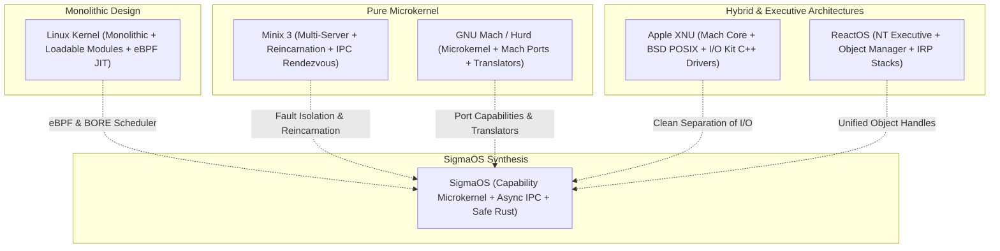

# Kernel Architectures Synthesis & Comparative Analysis

> **Principles:** ARCHITECTURE · CLEAR ABSTRACTION · FAIL-FAST SYSTEM · GALL'S LAW · INFORMATION HIDING · INTERRUPT HANDLING DISCIPLINE · INVERSION OF CONTROL · MEMORY SAFETY · MINIMAL KERNEL PHILOSOPHY · MODULAR KERNEL DESIGN · PROCESS ISOLATION · ZERO-COPY

This specification synthesizes the design patterns, concurrency mechanisms, and structural guarantees of five influential operating system kernels into the **SigmaOS Microkernel Architecture**.

---

## 1. Comparative Kernel Architectures



---

## 2. In-Depth Architectural Comparison

| Kernel | Architecture Type | Concurrency & Scheduling | Driver Model | Fault Recovery |
| :--- | :--- | :--- | :--- | :--- |
| **Linux** | Monolithic | CFS / EEVDF / BORE, RCU locks | In-kernel C drivers, GPL exports | Kernel panic, kexec crash dumps |
| **GNU Hurd** | Microkernel (Mach) | Threads on Mach ports, RPC queues | Userspace servers via Mach IPC | Server restart via parent process |
| **Minix 3** | Pure Microkernel | Priority-driven round-robin queues | 100% userspace, isolated address spaces | Reincarnation Server transparently restarts crashed drivers |
| **ReactOS** | NT Hybrid Executive | 32 priority levels, Deferred Procedure Calls (DPC) | Windows Driver Model (WDM) IRP packets | Blue Screen (BSOD), dump logging |
| **XNU** | Hybrid (Mach+BSD) | Mach scheduling, real-time audio threads | I/O Kit (object-oriented C++ in kernel) | Kernel panic, crash logs |
| **SigmaOS** | **Safe Microkernel** | **Zero-lock lock-free queues, BORE interactive boost** | **Userspace IPC servers in safe Rust (`#![no_std]`)** | **Crash-safe supervisor, instant service respawn** |

---

## 3. Key Architectural Patterns Adopted by SigmaOS

### 3.1. Minix-Style Fault Isolation (Reincarnation Supervisor)
In SigmaOS, all hardware drivers (network, disk, GPU display) execute as unprivileged userspace processes. When a driver encounters an invariant violation:
1. The microkernel terminates the faulty driver process without halting the OS.
2. The `SigmaOS-system` init supervisor respawns the driver within `< 5ms`.
3. Open file descriptors and IPC channels are re-bound using stored checkpoint state.

### 3.2. Mach & Hurd Port Capability Model
All system communication is mediated through unforgeable capability tokens:
```rust
#[derive(Debug, Clone, Copy, PartialEq, Eq)]
pub struct PortRight {
    port_id: u64,
    rights: PortCapability,
}

pub enum PortCapability {
    Receive,
    Send,
    SendOnce,
}

pub trait IpcEndpoint {
    fn send(&self, msg: ZeroCopyMessage, right: PortRight) -> Result<(), IpcError>;
    fn receive(&self, right: PortRight) -> Result<ZeroCopyMessage, IpcError>;
}
```

### 3.3. ReactOS / NT Object Manager
Unified naming, access control, and reference counting for all OS primitives (processes, threads, events, timers, ports, and files).

### 3.4. Linux BORE (Burst-Oriented Response Enhancer) Scheduler
Prevents background jobs from starving interactive GUI window tasks, ensuring responsive 120Hz/144Hz desktop compositor performance.
