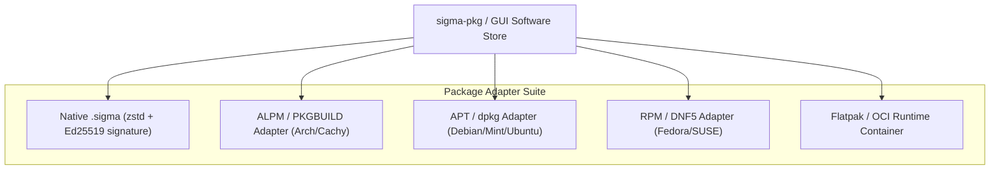

# Linux Universal Distribution Parity Specification (Advanced)

> **Principles:** AVOID FRAGMENTATION · CODE REUSABILITY · COMMUNITY-ORIENTED DEVELOPMENT · COMPONENT ISOLATION · DISCOVERABILITY · FAST-ISOLATED-REPEATABLE-SELF VALIDATING-TIMELY · GALL'S LAW · MODULARITY · MULTIPLE REPOSITORY · OPEN STANDARD AND INTEROPERABILITY · PACKAGE MANAGEMENT PARITY · USER FREEDOM AND CONTROL

This specification outlines the cross-distribution parity framework of SigmaOS, integrating the best architectural traits of 15 leading Linux distributions and innovative independent operating systems.

---

## 1. Distribution Innovation Mapping

| Distribution | Foundational Innovation | SigmaOS Repository / Subsystem | Key Principle |
| :--- | :--- | :--- | :--- |
| **Linux Mint** | Desktop user experience, XApps, MintUpdate, Cinnamon | `SigmaOS-xapp`, `SigmaOS-update`, `SigmaOS-desktop` | LEAST ASTONISHMENT |
| **Omarchy Linux** | Minimalist micro-desktop, Limine bootloader, Arch base | `SigmaOS-bootloader`, `SigmaOS-term`, `SigmaOS-ISO` | KEEP IT SIMPLE STUPID |
| **Arch Linux** | Rolling release, PKGBUILD, pacman, AUR simplicity | `SigmaOS-packages`, `SigmaOS-dev-tools` | PRISTINE SOURCES |
| **CachyOS** | BORE scheduler, x86-64-v3/v4 micro-architecture tuning | `SigmaOS-kernel`, scheduler core | CACHE CONSCIOUS DESIGN |
| **Debian** | Pristine packaging, DFSG guidelines, rock-solid stability | `SigmaOS-daemon-apt`, `SigmaOS-apturl` | PRACTICAL LICENSING AWARENESS |
| **Elementary OS** | Pantheon desktop shell, Granite HIG, curated AppCenter | `SigmaOS-desktop-environment`, `SigmaOS-theme-y` | CLEAR ABSTRACTION |
| **EndeavourOS** | Calamares installer, user-centric community tooling | `SigmaOS-installer`, `SigmaOS-welcome-screen` | COMMUNITY-ORIENTED DEVELOPMENT |
| **Fedora** | RPM-OSTree immutable base, Silverblue, SELinux enforcement | `SigmaOS-security`, `SigmaOS-timeshift` | SECURE DEFAULTS |
| **Gentoo** | USE flags, source compilation optimization, modularity | `SigmaOS-dev-tools`, build matrix | HIGH PERFORMANCE OPTIMIZATION |
| **Kali Linux** | Offensive security toolkit, live forensic mode | `SigmaOS-security`, forensic modules | DEFENSIVE & OFFENSIVE AWARENESS |
| **Parrot OS** | Lightweight security & privacy environment, sandbox default | `SigmaOS-security`, `SigmaOS-vpn-pia` | PROCESS ISOLATION |
| **Qubes OS** | Security by compartmentalization, Xen domains, split GPG | `SigmaOS-security`, microkernel IPC domains | COMPONENT ISOLATION |
| **Redox OS** | 100% Rust microkernel, Ion shell, Relibc, RedoxFS | `SigmaOS-kernel`, `SigmaOS-filesystem` | MEMORY SAFETY |
| **Slackware** | Unix simplicity, plain text config, non-intrusive init | `SigmaOS-dots-configuration`, `SigmaOS-system` | WORSE IS BETTER |
| **openSUSE** | YaST unified control center, Snapper Btrfs integration | `SigmaOS-control-center`, `SigmaOS-timeshift` | CENTRALIZED CONFIGURATION |
| **Ubuntu** | Universal accessibility, Cloud-init, Netplan automation | `SigmaOS-accessibility`, `SigmaOS-automate` | ZERO-ONE-INFINITY |

---

## 2. Package Management Universal Interoperability

SigmaOS provides a unified package management gateway (`SigmaOS-packages`) that interfaces with all major packaging formats:

---

## 3. Desktop Environments & Compositor Synthesis

- **Zenith Wayland Compositor:** Combines Cinnamon/Pantheon elegance with Hyprland dynamic tiling and smooth gesture physics.
- **XApp Compatibility:** Complete support for XApp status plugins, thumbnailers, and desktop portal extensions (`SigmaOS-xapp`, `SigmaOS-desktop-portal`).
- **Immutable Root with Mutable Overlays:** Modeled on Fedora Silverblue and openSUSE MicroOS: read-only system root mounted under `/usr`, with Btrfs/ZFS snapshots enabling instant rollback via `SigmaOS-timeshift`.
