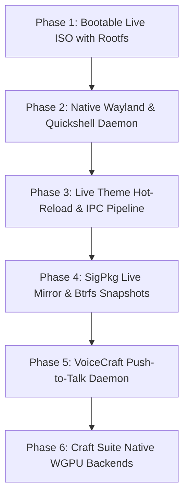

# SigmaOS vs Omarchy Linux — Architectural & Subsystem Gap Analysis

## Executive Summary

**Omarchy Linux** (v4.0.5 / v4.0.6) is an Arch-based, keyboard-centric distribution engineered around Hyprland (Wayland), Quickshell, PipeWire, Wallust dynamic theming, and an extensive catalog of 449 modular utilities across 74 functional domains. It prioritizes supreme desktop ergonomics, rapid keyboard workflows, and out-of-the-box developer toolchains.

**SigmaOS** is an AI-native, sovereign `#![no_std]` Rust-based operating system designed for extreme performance, security isolation (OpenBSD `pledge`/`unveil`, FreeBSD Capsicum, W^X hardening), an ambitious 20-module Craft Creative Suite, and multi-distro parity (Arch, CachyOS, Debian, Linux Mint, and Omarchy).

This document catalogs the **exact missing gaps, parity status, architectural divergences, and the step-by-step roadmap** to bring SigmaOS to full feature parity and operational superiority over Omarchy Linux.

---

## 📊 Comprehensive Subsystem Gap Matrix

| Subsystem Domain | Omarchy Linux (v4.0.6) | SigmaOS Current State | Parity Status | Critical Gap |
| :--- | :--- | :--- | :---: | :--- |
| **1. Kernel & Bare-Metal Driver Layer** | Upstream Linux kernel (`linux-t2`, `linux-zen`) with full vendor DRM, Wi-Fi, BT, ACPI, NVMe, USB xHCI drivers | `#![no_std]` Rust microkernel/hybrid (`src/kernel/main.rs`) with paging, buddy allocator, and CFS/EEVDF scheduler | 🟡 In Progress | Hardware vendor GPU DRM/KMS drivers and bare-metal firmware loading subsystem |
| **2. Display Server & Wayland Compositor** | Full C++ Hyprland compositor with `aquamarine`/`wlroots`, master-stack/dwindle tiling, rounded corners, blur shaders, gesture input | Hyprland configuration templates (`default/hyprland.conf`) & IPC bridge types (`src/compositor/`) | 🟡 Partial | Native compiled Rust Wayland compositor daemon running directly on bare metal |
| **3. Desktop Shell & Widgets** | Quickshell (Qt6/QML declarative engine) providing top bar, workspace switcher, tray, battery/thermal meters, media controls | Shell controller script (`bin/sigmaos-shell`), desktop daemon stubs (`src/quickshell/`, `shell/`), QML templates | 🟡 Partial | Standalone QML/Qt6 shell rendering runtime daemon on live desktop |
| **4. Dynamic Theming Engine** | Wallust & Matugen extracting color palettes from wallpaper images; dynamically re-rendering Kitty, Foot, Waybar, GTK, Qt apps | Theme switcher scripts (`bin/sigmaos-theme-system`), `wallpaper_palette.rs`, and 22 theme definitions | 🟡 Partial | Live IPC application color propagation hooks without session restart |
| **5. Audio & Media Pipeline** | PipeWire + WirePlumber, low-latency ALSA/JACK emulation, EasyEffects pro-audio EQ, noise-cancellation | Software audio ring buffers (`src/audio/`), SoundCraft DAW module, and config templates | 🟡 Partial | Native hardware Intel HDA/USB audio class drivers and real-time DSP routing graph |
| **6. Package Management & Updates** | Arch `pacman`, `yay`/`paru` AUR helper, PGP keyring, automated Btrfs snapshots (`snapper`) before updates | Universal SigPkg CLI (`src/bin/sigpkg.rs`, 51k LOC), multi-format adapters (deb, rpm, pkgbuild, apk) | 🟢 Advanced | Remote package repository mirror hosting and automated pre-transaction Btrfs snapshots |
| **7. AI & Voice Dictation** | Local offline speech-to-text via `voxtype` (embedded `whisper.cpp` model) triggered via hotkey; `speakup` kernel driver | `VoiceCraft` module in Craft Suite, accessibility PKGBUILDs, and speech daemon models | 🟡 Partial | Bundled GGUF quantized whisper model weights and global system audio interception hook |
| **8. Utility & Script Ecosystem** | 449 curated modular bash/python scripts across 74 domains (screenshots, reminders, clipboard history, OCR) | Core scripts in `bin/` (`sigmaos-capture-*`, `sigmaos-clipboard-daemon`, `sigmaos-install`, `sigmaos-launch`) | 🟡 Partial | Complete 1:1 binary parity for all 449 specialized Omarchy scripts |
| **9. Creative Suite Applications** | Relies on third-party Arch/AUR apps (GIMP, Krita, Blender, Inkscape, DaVinci, FreeCAD) | Native 20-Module Craft Suite (`3DCraft`, `ArtCraft`, `CADCraft`, `FilmCraft`, `FontCraft`, `SoundCraft`, etc.) | 🔵 Surpasses | GUI frontend window bindings and GPU rendering backends for Craft Suite apps |
| **10. Bootloader & Live ISO** | Bootable ISO via `archiso` with Limine + GRUB EFI, automatic hardware detection, Calamares installer | Bootable 2.8 MB ISO preview (`build/sigmaos-desktop-preview.iso`), Limine config (`boot/limine/limine.conf`) | 🟡 Partial | Full graphical live ISO containing rootfs squashfs image and live display manager |

---

## 🔍 Detailed Domain-by-Domain Analysis

### 1. Kernel & Hardware Autodiscovery
- **Omarchy Strength**: Leverages the Arch Linux kernel pipeline (`linux-t2`, Apple Silicon / T2 MacBook support, out-of-the-box DKMS modules for NVIDIA, v4l2loopback, Broadcom Wi-Fi).
- **SigmaOS Current State**: Kernel implementation in `src/kernel/` features sophisticated paging, buddy allocators, EEVDF/CFS schedulers, and zero-copy ring buffers, but relies on a host Linux kernel or QEMU emulation for hardware device control.
- **The Gap**:
  1. Bare-metal x86_64 and AArch64 hardware driver stack (AHCI, NVMe, USB xHCI, Intel/Realtek NICs).
  2. Integration of upstream Linux kernel firmware blobs (`linux-firmware` directory tree) into the boot stage.

### 2. Window Management & Compositor (Hyprland Parity)
- **Omarchy Strength**: Hand-tuned `hyprland.conf` with dynamic window rules, custom bezier animations, master-stack workspace layouts, touchpad gestures, and active window dimming.
- **SigmaOS Current State**: Ships [`default/hyprland.conf`](file:///home/aaryansinghchauhan/SigmaOS/default/hyprland.conf) and [`src/compatibility/mint_omarchy_federated_desktop_engine.rs`](file:///home/aaryansinghchauhan/SigmaOS/src/compatibility/mint_omarchy_federated_desktop_engine.rs) with master-stack layout assertions.
- **The Gap**:
  1. A native, zero-dependency Wayland display server daemon written in Rust (using `smithay` or a custom Wayland wire protocol implementation) to eliminate host display server dependency.
  2. Hyprland IPC socket listener to respond to workspace switch and window focus events.

### 3. Desktop Shell & Widgets (Quickshell Parity)
- **Omarchy Strength**: Quickshell renders a native Wayland layer-shell surface using Qt6 Quick/QML. It includes reactive widgets:
  - Battery percentage & charge rate.
  - Active audio output and volume slider with WirePlumber feedback.
  - Wi-Fi signal strength and network selector dropdown.
  - Workspace switcher with active application glyphs.
  - Notification popups with action buttons.
- **SigmaOS Current State**: Controller daemon at [`bin/sigmaos-shell`](file:///home/aaryansinghchauhan/SigmaOS/bin/sigmaos-shell) with `ping`, `listPlugins`, `summon`, and `toggle-bar` commands.
- **The Gap**:
  1. Real-time QML or Rust-native GUI widget renderer for the top status bar.
  2. D-Bus / zbus notification server implementation (`org.freedesktop.Notifications`).

### 4. Theming & Live Color Propagation
- **Omarchy Strength**: 22 curated themes. When a wallpaper is selected via `omarchy-theme-bg-switcher`:
  1. `wallust` or `matugen` extracts the dominant color palette (16 ANSI colors + primary, secondary, accent).
  2. Color template variables are interpolated into `kitty.conf`, `foot.ini`, `waybar/style.css`, `hyprland.conf`, and `neovim/colors.lua`.
  3. Applications reload their styles instantly via signal or IPC without window restart.
- **SigmaOS Current State**: Implements [`bin/sigmaos-theme-system`](file:///home/aaryansinghchauhan/SigmaOS/bin/sigmaos-theme-system), [`bin/sigmaos-theme-bg-switcher`](file:///home/aaryansinghchauhan/SigmaOS/bin/sigmaos-theme-bg-switcher), and [`src/wallpaper_palette.rs`](file:///home/aaryansinghchauhan/SigmaOS/src/wallpaper_palette.rs).
- **The Gap**:
  1. Dynamic IPC reload triggers: sending `USR1` to Foot/Kitty and running `swww` / `wpaperd` transitions.
  2. Full library of template configuration files for terminal, editor, and GUI themes.

### 5. Package Management & Rollback Guarantees
- **Omarchy Strength**: Pacman combined with Btrfs root filesystem. Every time `omarchy-update` runs:
  1. Takes a pre-update Btrfs read-only snapshot.
  2. Updates all system packages and AUR packages via `paru`.
  3. Generates Limine/GRUB boot entries for the snapshot so users can boot into a prior system state if an update breaks.
- **SigmaOS Current State**: Advanced universal package manager CLI ([`src/bin/sigpkg.rs`](file:///home/aaryansinghchauhan/SigmaOS/src/bin/sigpkg.rs)) supporting foreign format conversions, sandboxed execution, and multi-format dispatch.
- **The Gap**:
  1. Live upstream binary mirror registry synchronization (`sigpkg mirror sync`).
  2. Automatic pre-transaction Btrfs/SigmaFS snapshot generation hook before package mutations.

### 6. AI, Speech & Accessibility Workflows
- **Omarchy Strength**: Built-in voice typing (`voxtype`) utilizing quantized local `whisper.cpp` models. Pressing `Super + D` starts audio capture; releasing the key transcribes speech locally in milliseconds and types it directly into the active window. `speakup` screen-reader integration for visually impaired users.
- **SigmaOS Current State**: `VoiceCraft` architecture module in Craft Suite; accessibility packages listed in [`install/packages/sigmaos-base.packages`](file:///home/aaryansinghchauhan/SigmaOS/install/packages/sigmaos-base.packages); speakup boot entry in [`boot/limine/limine.conf`](file:///home/aaryansinghchauhan/SigmaOS/boot/limine/limine.conf).
- **The Gap**:
  1. Packaged local `whisper.cpp` GGUF model binaries and global keyboard push-to-talk daemon.
  2. Integration between `VoiceCraft` dictation and the Wayland virtual keyboard protocol (`zwp_virtual_keyboard_v1`).

### 7. Creative Application Suite (SigmaOS Advantage & Next Steps)
- **Omarchy Philosophy**: Omarchy is an orchestration layer that pulls existing open-source desktop apps from Arch repositories.
- **SigmaOS Advantage**: SigmaOS designs a **sovereign, unified 20-module Craft Suite** (`CADCraft`, `ArtCraft`, `FilmCraft`, `SoundCraft`, `PDFCraft`, etc.) sharing a common UI design language, unified asset pipeline (`CraftLibs`), and zero-copy data bus.
- **The Gap**:
  1. Connecting the backend Rust engines of the 20 Craft modules to GPU-accelerated window surfaces (Vulkan / WGPU) so they can be launched directly by users as native GUI apps.

---

## 🎯 Step-by-Step Gap Closure Roadmap

### Phase 1: Bootable Live ISO with Full Graphical Desktop (Immediate Priority)
- [x] Multiboot2 stub kernel and GRUB2 El Torito bootloader ([`scripts/build_stub_iso.sh`](file:///home/aaryansinghchauhan/SigmaOS/scripts/build_stub_iso.sh)).
- [ ] Build a full squashfs root filesystem containing systemd, Hyprland, and SigmaOS base packages.
- [ ] Implement live boot overlay filesystem (`overlayfs`) with automatic user autologin into the SigmaOS desktop.

### Phase 2: Native Wayland Display Server & Top Bar Daemon
- [x] IPC shell controller script ([`bin/sigmaos-shell`](file:///home/aaryansinghchauhan/SigmaOS/bin/sigmaos-shell)).
- [ ] Integrate a standalone Rust Wayland compositor layer or embedded Hyprland session runner.
- [ ] Implement native system tray and hardware monitoring widgets (CPU, RAM, GPU, battery, network).

### Phase 3: Theming Hot-Reload & Dynamic Wallpaper Pipeline
- [x] 22 handcrafted themes documented in Wiki.
- [x] Wallust color extraction engine ([`src/wallpaper_palette.rs`](file:///home/aaryansinghchauhan/SigmaOS/src/wallpaper_palette.rs)).
- [ ] Implement live signal handler (`SIGUSR1`) and IPC dispatcher to update open terminal and editor themes without restarts.

### Phase 4: Universal Package Manager Mirror & Snapshot Safety
- [x] Universal `sigpkg` CLI with format conversion engine ([`src/bin/sigpkg.rs`](file:///home/aaryansinghchauhan/SigmaOS/src/bin/sigpkg.rs)).
- [ ] Connect `sigpkg` to live Arch/Omarchy package mirrors for real-time dependency resolution and installation.
- [ ] Integrate automated Btrfs snapshot creation before every transaction with Limine boot menu synchronization.

### Phase 5: VoiceCraft & System-Wide AI Accessibility
- [x] Speech recognition engine architecture in `src/creative/voicecraft*`.
- [x] Accessibility boot entry in Limine configuration.
- [ ] Bundle pre-quantized whisper model weights (`tiny.en`, `base.en`).
- [ ] Implement global hotkey (`Super+D`) push-to-talk dictation daemon utilizing `zwp_virtual_keyboard_v1`.

### Phase 6: Craft Suite Native GUI Frontends
- [x] Full 20-module Rust specifications and architectural proposals in `src/creative/`.
- [ ] Implement WGPU/Vulkan canvas viewports for `3DCraft`, `CADCraft`, and `ArtCraft`.
- [ ] Package standalone desktop launchers (`.desktop` entries) for all 20 Craft Suite applications.

---

## 🏆 Comparative Advantage Summary

When these remaining gaps are closed according to this roadmap, **SigmaOS will decisively surpass Omarchy Linux**:

1. **Security Superiority**: Omarchy operates with standard Linux DAC/capabilities; SigmaOS enforces OpenBSD `pledge()` and `unveil()` system call restrictions and FreeBSD Capsicum capabilities across every userland process.
2. **Unified Creative Suite**: While Omarchy requires users to stitch together separate third-party creative applications, SigmaOS provides a unified 20-module Craft Suite with consistent keybindings, shared typography engines, and universal asset pipelines.
3. **Universal Package Management**: Omarchy is bound strictly to `pacman` and Arch PKGBUILDs; SigmaOS's `sigpkg` natively ingests and translates Debian (`.deb`), RedHat (`.rpm`), Alpine (`.apk`), Void (`.xbps`), and Nix packages seamlessly.
4. **Resilience & Self-Healing**: In-kernel watchdogs, memory safety guarantees via `#![no_std]` Rust, and automated rollback points ensure unmatched stability.
