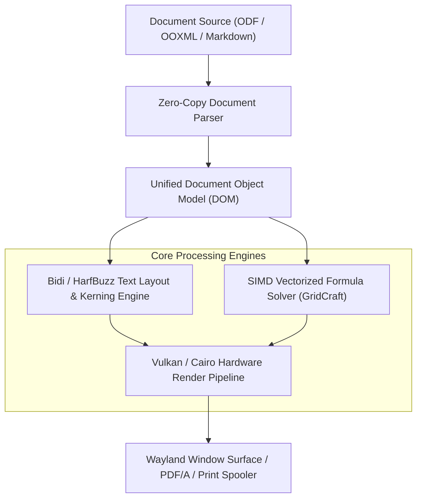

# Office and Productivity Suites Specification

> **Principles:** ABSTRACTION · CODE REUSABILITY · INTERFACE SEGREGATION · OPEN STANDARD AND INTEROPERABILITY · SEPARATION OF CONCERNS · UNIFORM ACCESS · USER FREEDOM AND CONTROL

This specification documents the document processing, spreadsheet calculation, presentation authoring, vector drawing, mathematical typesetting, and database frontend architectures supported across SigmaOS.

---

## 1. Office Module Matrix

SigmaOS delivers native productivity applications through the **Craft Creative Suite** while maintaining complete file-format and interface parity with **LibreOffice** and **Apache OpenOffice**.

| Productivity Domain | LibreOffice Equivalent | Apache OpenOffice | SigmaOS Craft Engine | Supported File Formats |
| :--- | :--- | :--- | :--- | :--- |
| **Word Processing** | Writer | Writer | `WordCraft` | `.odt`, `.docx`, `.rtf`, `.txt`, `.md` |
| **Spreadsheets & Modeling** | Calc | Calc | `GridCraft` | `.ods`, `.xlsx`, `.csv`, `.tsv`, `.arrow` |
| **Presentations & Decks** | Impress | Impress | `DeckCraft` | `.odp`, `.pptx`, `.pdf`, interactive HTML |
| **Vector Graphics & Flow** | Draw | Draw | `VectorCraft` | `.odg`, `.svg`, `.eps`, `.pdf` |
| **Equation & Formula Typesetting** | Math | Math | `MathCraft` | MathML, LaTeX, OpenFormula |
| **Relational Database Frontend** | Base | Base | `DataCraft` | SQLite, DuckDB, PostgreSQL, ODBC |

---

## 2. Document Model Architecture

---

## 3. High-Performance Spreadsheet Engine (GridCraft)

Unlike legacy office suites with row-oriented calculations:
- **Columnar Paging:** Spreadsheets store data in Apache Arrow-compatible memory chunks.
- **SIMD Formula Acceleration:** Multi-core parallel evaluation of formulas (`SUM`, `VLOOKUP`, `XLOOKUP`, `INDEX/MATCH`, statistical regressions).
- **Embedded SQL Integration:** Direct in-sheet SQL querying via DuckDB integration without separate database drivers.

---

## 4. Theme & Desktop Integration
- **LibreOffice Mint Theming:** Seamless support for `libreoffice-style-mint` icons and GTK3/GTK4 theme sync (`SigmaOS-office`, `SigmaOS-theme-sync`).
- **Font Rendering:** Subpixel anti-aliasing with FreeType and HarfBuzz shaped typography.
