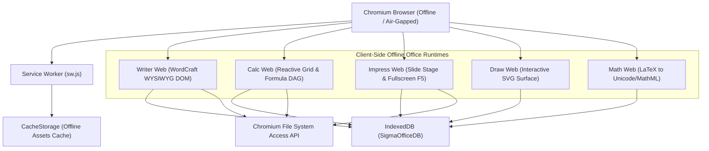

# Office and Productivity Suites Specification

> **Principles:** ABSTRACTION · CODE REUSABILITY · INTERFACE SEGREGATION · OPEN STANDARD AND INTEROPERABILITY · SEPARATION OF CONCERNS · UNIFORM ACCESS · USER FREEDOM AND CONTROL · ZERO-COPY · FIRST TESTING · LOCALITY OF REFERENCE · SECURE DEFAULTS

This specification documents the document processing, spreadsheet calculation, presentation authoring, vector drawing, mathematical typesetting, database frontend, AI-assisted document generation, real-time collaboration, ODF/OOXML packaging, UNO macro scripting, bibliography management, and cryptographic audit architectures implemented in **SigmaOS** and **[`SigmaOS-office`](https://github.com/AaryanSinghChauhan09/SigmaOS-office)**.

---

## 1. Office Module Matrix & Upstream Inspirations

SigmaOS delivers native productivity capabilities inspired by leading open-source and modern office suites:
- **LibreOffice & Apache OpenOffice:** Complete 6-module application parity (Writer, Calc, Impress, Draw, Math, Base), ODF/OOXML zip packaging, UNO service manager/scripting model, and icon/style themes (`libreoffice-mint`, `libreoffice-breeze`, `libreoffice-elementary`).
- **GenOffice:** Offline-first generative AI assistant for prompt-to-document synthesis, presentation generation, summarization, readability analysis, and template expansion.
- **OnlyOffice:** Operational Transformation (OT) co-authoring engine, document locking, threaded comments, user presence telemetry, JWT session token verification, and SHA-256 Merkle revision chains.
- **CraftOffice (Craft Creative Suite):** Native `.wcf` (WordCraft), `.gcf` (GridCraft), `.dcf` (DeckCraft), `.vcf` (VectorCraft), `.mcf` (MathCraft), and `.dbcf` (DataCraft) format processing.

| Productivity Domain | LibreOffice / OpenOffice | OnlyOffice Parity | SigmaOS Craft Engine | Supported File Formats |
| :--- | :--- | :--- | :--- | :--- |
| **Word Processing** | Writer | Document Server | `WordCraft` | `.odt`, `.docx`, `.wcf`, `.rtf`, `.txt`, `.md` |
| **Spreadsheets & Modeling** | Calc | Spreadsheet Server | `GridCraft` | `.ods`, `.xlsx`, `.gcf`, `.csv`, `.tsv`, `.arrow` |
| **Presentations & Decks** | Impress | Presentation Server | `DeckCraft` | `.odp`, `.pptx`, `.dcf`, `.pdf`, interactive HTML |
| **Vector Graphics & Flow** | Draw | Shape Engine | `VectorCraft` | `.odg`, `.svg`, `.vcf`, `.eps`, `.pdf` |
| **Formula Typesetting** | Math | Equation Editor | `MathCraft` | MathML, LaTeX, `.mcf`, OpenFormula |
| **Relational Database** | Base | Data Connector | `DataCraft` | SQLite, DuckDB, `.dbcf`, ODBC, CSV |
| **AI Document Assistant** | — | AI Plugins | `GenOffice AI` | AST synthesis, Markdown summaries |
| **Real-Time Collaboration** | — | Co-authoring Core | `OnlyOffice Collab` | Operational Transform, Threaded Comments |
| **Package Archival** | ODF / OOXML Filters | Document Builder | `PackageEngine` | Standard `.odt`, `.ods`, `.docx`, `.xlsx` ZIPs |
| **Automation & Macros** | UNO Service Manager | JS Macro Plugins | `UNOMacroEngine` | Sandboxed Python Scripting, Event Hooks |
| **Scholarly Publishing** | Bibliography Database | Zotero/Mendeley Plugin | `BibTOCEngine` | BibTeX, APA/IEEE Citations, Footnotes, TOC |
| **Security & Auditing** | Digital Signatures | JWT Document Tokens | `CollabSecurity` | Merkle Hash Chains, Visual Word Diff, HMAC Tokens |

---

## 2. System Architecture

```mermaid
graph TD
    UI["SigmaOS Zenith Desktop / CLI (sigma-office)"] --> BRIDGE["CraftBridge & Format Filters"]
    
    subgraph Core Processing Engines (SigmaOS-office)
        WRITER["DocumentEngine (Writer / WordCraft)"]
        CALC["SpreadsheetEngine (Calc / GridCraft)"]
        IMPRESS["PresentationEngine (Impress / DeckCraft)"]
        DRAW["VectorDrawEngine (Draw / VectorCraft)"]
        MATH["MathEngine (Math / MathCraft)"]
        BASE["DatabaseEngine (Base / DataCraft)"]
        GENAI["GenOffice AI Assistant"]
        COLLAB["OnlyOffice Collab & OT Engine"]
        PACKAGING["ODF & OOXML Zip Packagers"]
        UNO["UNO Macro & Scripting Runtime"]
        BIB["BibTeX, Footnotes & TOC Engine"]
        SEC["Merkle Audit & Session Tokens"]
        STYLE["Style & Icon Coverage Planner"]
    end
    
    BRIDGE --> WRITER
    BRIDGE --> CALC
    BRIDGE --> IMPRESS
    BRIDGE --> DRAW
    BRIDGE --> MATH
    BRIDGE --> BASE
    
    PACKAGING --> WRITER
    PACKAGING --> CALC
    
    UNO --> WRITER
    UNO --> CALC
    
    BIB --> WRITER
    SEC --> COLLAB
    GENAI --> WRITER
    GENAI --> IMPRESS
    COLLAB --> WRITER
    STYLE --> UI
```

---

## 3. Sub-Engine Implementation Details

### 3.1 Document Engine (`src/document_engine.py`)
- **AST Architecture:** Hierarchical representation of `CharacterStyle`, `TextRun`, `Paragraph` (with alignment, heading levels, and bullet lists), `Table` with `TableCell` spans, and `TrackedChange` logs.
- **Page Layout:** `PageStyle` handling margins, page orientation (`portrait`/`landscape`), headers, footers, and page counters.
- **Serialization Filters:** Multi-format conversion to Markdown, JSON, and plain text.
- **Metrics:** Real-time word count and character count calculation without external dependencies.

### 3.2 Spreadsheet Engine (`src/spreadsheet_engine.py`)
- **Cell Matrix:** Sparse 2D coordinate grid parsing alphanumeric coordinates (`A1`, `B5`, `AA10`) to 0-based indices and vice versa.
- **Formula DAG Evaluator:** Recursive formula evaluator supporting:
  - Range aggregations: `SUM`, `AVERAGE`, `MIN`, `MAX`, `COUNT`, `STDEV`.
  - OpenFormula Lookups: `VLOOKUP(val, range, col_idx)`, `INDEX(range, row, col)`.
  - String manipulation: `CONCATENATE`, `UPPER`, `LOWER`, `TRIM`, `LEN`.
  - Math & Conditionals: `IF(cond, true_val, false_val)`, `ROUND`, `ABS`.
- **Topological Cycle Detection:** Guard stack detecting circular cell dependencies and raising fail-fast errors instead of recursion limits.
- **CSV Engine:** Bidirectional streaming CSV export and import.

### 3.3 Presentation Engine (`src/presentation_engine.py`)
- **Slide Deck Structure:** Presentation AST managing `Slide` collections, themes (`catppuccin-mocha`), transitions (`fade`, `wipe`, `push`), and speaker notes.
- **Layouts:** `title`, `title_content`, `two_column`, `conclusion`.
- **Markdown Interop:** Bidirectional export and import supporting slide delimiters (`---`) and presenter note blocks (`<!-- Notes: ... -->`).

### 3.4 Vector Draw Engine (`src/vector_draw_engine.py`)
- **Primitive Shapes:** `Rectangle` (with rounded corners `rx`, `ry`), `Ellipse`, `Line`, `Connector` (with orthogonal routing and arrow markers), `TextShape`, `BezierCurve` (cubic Bezier with parameter sampling), and `Polygon`.
- **Styling & Geometry:** `StrokeStyle` (color, width, dash array), `FillStyle` (opacity, transparency), and 2D affine `Transform` (translate, rotate, scale).
- **SVG Generation:** Standards-compliant W3C SVG vector export.

### 3.5 Math & Formula Engine (`src/math_engine.py`)
- **Symbol Translation:** Pure lookup dictionary translating LaTeX tokens (`\alpha`, `\sum`, `\int`, `\pi`, `\infty`, `\approx`, `\leq`, `\times`, etc.) into Unicode glyphs.
- **Structural Conversion:** LaTeX fractions `\frac{a}{b}` and exponents/subscripts into typographic forms.
- **MathML XML:** Generating W3C `<math>` markup with `<mo>`, `<mn>`, `<mi>`, and `<mrow>` nodes.

### 3.6 Database Engine (`src/database_engine.py`)
- **Relational Model:** Strongly-typed column definitions (`TEXT`, `INTEGER`, `REAL`, `BOOLEAN`, `DATE`, `BLOB`) with primary key validation and nullability constraints.
- **Query Builder:** Fluent query API supporting `.where(col, op, val)` (operators `=`, `!=`, `>`, `<`, `>=`, `<=`, `LIKE`, `IN`), `.order_by(col, descending)`, `.limit(count, offset)`, and `.aggregate(func, col)`.
- **Forms & Reports:** `FormDesign` field specifications and `ReportGenerator` for structured tabular text reports.

### 3.7 GenOffice AI Engine (`src/genoffice_ai.py`)
- **Deterministic Generation:** Prompt-to-document and prompt-to-presentation synthesis generating complete ASTs with structured headings, narrative, tables, and agendas.
- **Summarization:** Executive summary extraction and reading-time estimation.
- **Readability & Style:** Detection of passive voice constructions, sentence length auditing, and Flesch-Kincaid grade level scoring.
- **Template Engine:** Template variable expansion supporting `{{variable}}`, loops `{{#each items}}...{{/each}}`, and conditionals `{{#if condition}}...{{/if}}`.

### 3.8 OnlyOffice Collaboration Engine (`src/onlyoffice_collab.py`)
- **Operational Transformation (OT):** Atomic operations (`insert`, `delete`, `retain`, `format`) with deterministic rebasing against concurrent mutations.
- **Lock Management:** Pessimistic section/block locks with TTL expiry and optimistic concurrency revision control.
- **Threaded Annotations:** `CommentThread` and `CommentReply` trees anchored to document elements.
- **Telemetry:** Real-time user cursor presence tracking.

### 3.9 ODF & OOXML Packaging Engine (`src/odf_ooxml_engine.py`)
- **OpenDocument Packages:** In-memory construction of valid `.odt` and `.ods` zip archives with uncompressed `mimetype` entries, `META-INF/manifest.xml`, `meta.xml`, `styles.xml`, and `content.xml`.
- **Office Open XML Packages:** In-memory construction of `.docx` and `.xlsx` zip archives with `[Content_Types].xml`, `_rels/.rels`, `word/document.xml`, `xl/workbook.xml`, and `xl/worksheets/sheet1.xml`.
- **Package Inspector:** Non-destructive zip inspection sniffing media types and file manifests.

### 3.10 UNO Scripting & Macro Engine (`src/uno_macro_engine.py`)
- **Service Registry:** `XComponentContext` and `XMultiComponentFactory` providing component life-cycle management and factory instantiation.
- **Macro Runner:** Execution of registered macro scripts and sandboxed Python snippets with injected `XSCRIPTCONTEXT` and `ThisComponent` globals.
- **Event Dispatch Bus:** Event binding for document life-cycle hooks (`OnLoad`, `OnSave`, `OnCalculate`).

### 3.11 Bibliography & Table of Contents Engine (`src/bibliography_toc_engine.py`)
- **Automatic TOC:** Scans document headings to generate numbered hierarchy (`1`, `1.1`, `1.1.1`) and Markdown/text navigation tables with anchors.
- **BibTeX Parsing:** Regex-based AST parser extracting `@article`, `@book`, and `@inproceedings` citation records.
- **Citation Formatters:** Standard APA and IEEE reference list generation.
- **Footnotes & Endnotes:** Anchor-linked monotonic footnote numbering and bottom-of-page rendering.

### 3.12 Collaboration Security Engine (`src/collab_security.py`)
- **Merkle Hash Chain:** Cryptographic SHA-256 block chaining over all collaborative changesets ensuring untampered edit histories.
- **JWT Session Tokens:** HMAC-SHA256 authenticated collaboration session tokens with document permissions (`edit`, `comment`, `download`) and TTL expiration.
- **Visual Diff Engine:** Word-level diffing highlighting deleted (`[DEL: ...]`) and inserted (`[INS: ...]`) text runs.
- **Watermark Specification:** Overlay configuration for text, opacity, rotation angle, and SVG export.

### 3.13 Craft Bridge (`src/craft_bridge.py`)
- **Native Packages:** WordCraft (`.wcf`), GridCraft (`.gcf`), DeckCraft (`.dcf`), VectorCraft (`.vcf`), and MathCraft (`.mcf`).
- **Format Sniffer:** Unified JSON inspection and signature detection.

---

## 4. CLI Usage Guide (`sigma-office`)

The `sigma-office` binary provides a unified command-line interface:

```bash
# Style & Icon Planner
sigma-office mapping
sigma-office icons mint
sigma-office apply-plan mint
sigma-office verify mint --available available.txt

# Document Writer
sigma-office writer --title "Release Notes" --text "SigmaOS 2.0 Released." --format markdown

# Spreadsheet Calc (OpenFormula)
sigma-office calc --set A1=100 --set A2=200 --set A3==SUM(A1:A2)

# Presentation Impress
sigma-office impress --title "Keynote 2026" --slides 3

# Vector Draw
sigma-office draw --demo > diagram.svg

# Math Formula
sigma-office math "\sum_{i=1}^n x_i = \alpha"

# Relational Base
sigma-office base --demo

# GenOffice AI Assistant
sigma-office gen --topic "Microkernel Security" --type doc
sigma-office gen --summarize "Long text to summarize..."
sigma-office gen --review "Text to audit for passive voice and grade level."

# Collaboration & OT
sigma-office collab --demo

# ODF & OOXML Packaging
sigma-office odf --type odt --title "Whitepaper"
sigma-office ooxml --type docx --title "Enterprise Report"

# UNO Macro Scripting
sigma-office macro --code "result = ThisComponent.title.upper()"

# Table of Contents
sigma-office toc --sample

# Bibliography & Citations
sigma-office bib --style APA

# Visual Diff
sigma-office diff "Original draft text" "Modified draft text"

# Offline Chromium PWA Web Suite
sigma-office web --verify
sigma-office web --serve --port 8080
sigma-office web --export ./dist/web/

# Collaboration Security Token
sigma-office token --generate --doc-id doc_42 --user-id alice

# Deterministic Self-Tests
sigma-office self-test
```

---

## 5. Chromium-Based Browser Offline Architecture

SigmaOS-office provides a self-contained Progressive Web App (PWA) runtime engineered to run 100% offline in all Chromium-based browsers (Chromium, Google Chrome, Brave, Microsoft Edge, Opera, Vivaldi).



### 5.1 Service Worker & Cache-First Strategy (`web/sw.js`)
- Pre-caches all essential HTML, CSS, JavaScript, and SVG icons upon `install`.
- Intercepts all network fetch requests with a **Cache-First** strategy, ensuring instantaneous load times with 0 external network requests.
- Automatic navigation fallback to `index.html` for offline standalone execution.

### 5.2 Local Persistence via IndexedDB & File System Access API (`web/js/storage_engine.js`)
- **IndexedDB Stores:** Dedicated `documents`, `revisions`, and `settings` stores persisting documents directly on the user's device.
- **File System Access API:** Zero-copy local disk access in Chromium via `showOpenFilePicker()` and `showSaveFilePicker()`, allowing direct opening and saving of `.wcf`, `.gcf`, `.dcf`, `.csv`, `.md`, and `.svg` files on the host filesystem without cloud intermediaries.

### 5.3 Client-Side Pure JavaScript Engines
- **Writer Web (`web/js/writer_web.js`):** Client-side rich text processor with heading levels, lists, tables, live word/character counters, auto-save to IndexedDB, and `.wcf` / `.md` export.
- **Calc Web (`web/js/calc_web.js`):** Reactive spreadsheet grid with formula bar, computing `SUM`, `AVERAGE`, `MIN`, `MAX`, `COUNT`, `IF`, and arithmetic formulas in real-time, with streaming CSV and GridCraft `.gcf` export.
- **Impress Web (`web/js/impress_web.js`):** Slide authoring canvas with thumbnail sidebar, speaker notes, fullscreen presentation mode (F5 shortcut), and DeckCraft `.dcf` export.
- **Draw Web (`web/js/draw_web.js`):** Vector graphics tool supporting rectangles, ellipses, lines, and standard W3C SVG export.
- **Math Web (`web/js/math_web.js`):** Interactive formula typesetter translating LaTeX tokens to Unicode and MathML with an on-screen Greek symbol palette.

---

## 6. Quality & Deterministic Verification

All 78 unit tests in `tests/` execute in < 0.30 seconds with 0 network calls and 0 filesystem mutations outside temporary directories, strictly adhering to the **Arrange-Act-Assert (AAA)** and **FIRST** principles:
- Document Engine, Spreadsheet & OpenFormula: 19 tests
- Presentation & Slide Deck: 4 tests
- Math & Equation Typesetting: 4 tests
- Vector Draw & Database Engine: 5 tests
- GenOffice AI & OnlyOffice Collab: 9 tests
- Craft Bridge Format Interop: 5 tests
- ODF & OOXML Packaging: 4 tests
- UNO Scripting & Macro Execution: 4 tests
- Bibliography, Footnotes & TOC: 3 tests
- Collaboration Security & Merkle Audit: 4 tests
- Web Exporter & Offline PWA Assets: 4 tests
- Core CLI Integration & Self-Tests: 13 tests
