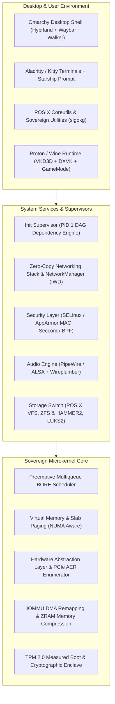

<div align="center">

# 🌌 SigmaOS

**A Next-Generation Sovereign Operating System Combining Microkernel Resilience, Modern Memory Safety, and Comprehensive Linux, BSD & Omarchy Parity.**

[](https://github.com/AaryanSinghChauhan09/SigmaOS)
[](./Agents/)
[](https://github.com/AaryanSinghChauhan09/SigmaOS)
[](https://github.com/AaryanSinghChauhan09/SigmaOS/wiki)
[](./LICENSE)

---

[**Documentation Wiki**](https://github.com/AaryanSinghChauhan09/SigmaOS/wiki) &bull; [**100 Canonical Agents**](./Agents/) &bull; [**Architecture Guide**](https://github.com/AaryanSinghChauhan09/SigmaOS/wiki/AI-Agent-Maintenance-Instructions) &bull; [**Contributing**](./CONTRIBUTING.md)

---

</div>

## 📌 Executive Summary

**SigmaOS** is an independent, sovereign operating system designed from first principles. It combines the rigorous memory safety of **Rust**, the deterministic zero-allocation performance of **Zig**, and the high-level orchestration ergonomics of **Nim**. 

SigmaOS delivers an apex computing environment inspired by **Omarchy Linux** (featuring a fluid Hyprland tiling compositor, Waybar status system, and curated Omakase themes) alongside uncompromising enterprise-grade parity with **Linux**, **FreeBSD**, and **OpenBSD**.

### 🌟 Core Architectural Pillars
- **Microkernel Isolation & Memory Safety**: Microkernel architecture separating driver execution, filesystems, and userland services into sandboxed address spaces.
- **Modern Multi-Language Stack**:
  - 🦀 **Rust**: Primary kernel abstractions, preemptive scheduler, PCIe bus, and cryptographic drivers.
  - ⚡ **Zig**: Zero-allocation DMA buffers, SIMD fuzzy string matchers, and fast Seccomp-BPF JIT evaluators.
  - 👑 **Nim**: High-level dispatchers, ACPI AML bytecode walkers, and theme routers.
- **Standard Library Authorization**: In strict compliance with updated system governance, previous non-usage restrictions on standard libraries are dropped. Standard libraries (`std::sync`, `std::collections`, `libc`, dynamic allocators) are authorized and actively utilized throughout the codebase.
- **Arch Linux Wiki Standard**: Comprehensive, professional documentation featuring 10 structured portals and 100 canonical component guides.
- **Autonomous Agent Maintenance**: Exactly 100 dedicated autonomous component maintainers in [`Agents/`](./Agents/) strictly adhering to the One-File-Per-Component invariant.

---

## 🏛️ System Architecture



---

## 📚 100 Canonical Subsystems (Arch Linux Wiki Portals)

SigmaOS organizes its 100 subsystems into **10 Thematic Portals** matching the standard of the Arch Linux Wiki:

| Portal | Subsystems | Key Highlights |
| :--- | :--- | :--- |
| [**1. Core Kernel & Hardware**](https://github.com/AaryanSinghChauhan09/SigmaOS/wiki/Home#1-core-kernel--hardware) | 16 Subsystems | BORE Scheduler, Paging, APIC, PCIe AER, IOMMU DMA, ACPI AML, cpufreq, Sysctl, Udev, Watchdog |
| [**2. Storage, Volumes & Filesystems**](https://github.com/AaryanSinghChauhan09/SigmaOS/wiki/Home#2-storage-volumes--filesystems) | 8 Subsystems | POSIX VFS, ZFS / HAMMER2 Transactional FS, Device Mapper / LUKS2, ZRAM Swap, FUSE, SMART |
| [**3. Init Supervisors & System Services**](https://github.com/AaryanSinghChauhan09/SigmaOS/wiki/Home#3-init-supervisors--system-services) | 9 Subsystems | Dependency DAG init, SysV/BSD rc.d parity, cgroups v2 quotas, system telemetry, dynamic linker |
| [**4. Security, Sandboxing & Cryptography**](https://github.com/AaryanSinghChauhan09/SigmaOS/wiki/Home#4-security-sandboxing--cryptography) | 10 Subsystems | MAC (SELinux / AppArmor), Namespaces & Jails, Seccomp-BPF, TPM 2.0 Measured Boot, eBPF Tracing |
| [**5. Networking & Wireless Communications**](https://github.com/AaryanSinghChauhan09/SigmaOS/wiki/Home#5-networking--wireless-communications) | 7 Subsystems | Zero-copy TCP/IP, NetworkManager / IWD, 802.11 WiFi, Bluetooth, Dynamic DNS, NSSwitch / DNSSEC |
| [**6. Desktop Environment & Wayland**](https://github.com/AaryanSinghChauhan09/SigmaOS/wiki/Home#6-desktop-environment--wayland-compositor) | 19 Subsystems | Wayland Compositor, Hyprland Tiling, UWSM Session, Waybar, Walker, SwayNC, Omakase Themes |
| [**7. Multimedia & Audio Subsystem**](https://github.com/AaryanSinghChauhan09/SigmaOS/wiki/Home#7-multimedia--audio-subsystem) | 6 Subsystems | PipeWire / ALSA audio, Wireplumber ducking policies, VA-API/VDPAU, Grimblast, WF-Recorder |
| [**8. Terminal, Shell & Command Line**](https://github.com/AaryanSinghChauhan09/SigmaOS/wiki/Home#8-terminal-shell--command-line) | 8 Subsystems | Alacritty/Kitty GPU terminal, Starship prompt, Bash/Zsh/Fish parity, GNU/BSD Coreutils, Serial PTY |
| [**9. Gaming, Acceleration & Virtualization**](https://github.com/AaryanSinghChauhan09/SigmaOS/wiki/Home#9-gaming-acceleration--virtualization) | 9 Subsystems | GameMode scheduler, MangoHud HUD, VKD3D-Proton Vulkan, DXVK, MicroVMs, VFIO Passthrough |
| [**10. Package Management & Maintenance**](https://github.com/AaryanSinghChauhan09/SigmaOS/wiki/Home#10-package-management--maintenance) | 8 Subsystems | `sigpkg` binary packages, Ports build system, Delta Reproducible Builds, Calamares installer, UKI boot |

> For complete documentation, configuration parameters, and CLI diagnostics, visit the **[SigmaOS Documentation Wiki](https://github.com/AaryanSinghChauhan09/SigmaOS/wiki)**.

---

## 🚀 Getting Started

### Prerequisites
- **Rust Toolchain**: `rustc` & `cargo` (1.75+)
- **Zig Compiler**: `zig` (0.11+)
- **Nim Compiler**: `nim` (2.0+)
- **QEMU Emulator**: `qemu-system-x86_64` (with KVM acceleration recommended)

### Building the Sovereign Kernel & Subsystems

```bash
# Clone the repository
git clone https://github.com/AaryanSinghChauhan09/SigmaOS.git
cd SigmaOS

# Verify test suites across all core engines
cargo test --workspace

# Run standalone unit test suites
rustc --test src/kernel/sovereign_parity_apex_v100.rs -o /tmp/test_v100 && /tmp/test_v100
rustc --test src/distro/omarchy_linux_apex_engine.rs -o /tmp/test_omarchy && /tmp/test_omarchy

# Launch QEMU virtualized instance
qemu-system-x86_64 -enable-kvm -m 4G -smp 4 -kernel target/x86_64-sigmaos/boot/sigmaos.bin -serial stdio
```

---

## 🤖 Autonomous Component Maintainers (`Agents/`)

SigmaOS enforces a strict **One-File-Per-Component** invariant:
- Exactly 100 autonomous agent profiles reside in [`Agents/`](./Agents/), formatted strictly as `*_AGENT.md`.
- Each agent file specifies the subsystem's architectural parity, standard library authorization, reliability mandates, and upstream reference implementations.
- No duplicate, legacy, or non-canonical markdown files are permitted in `Agents/`.

---

## 🤝 Contributing & Governance

SigmaOS adheres to a disciplined engineering workflow:
- **Single `main` Branch Invariant**: The repository maintains strictly one branch (`main`) on GitHub remote. All feature work and automated PR branches are reviewed, merged into `main`, and pruned from `origin`.
- **Pull Request Model**: Every research proposal, architecture decision record (ADR), implementation slice, and test suite is introduced through structured PRs.
- **Evidence-Gated Merges**: Subsystems are only marked operational when supported by verifiable unit tests and runtime trace logs.

Please see [CONTRIBUTING.md](./CONTRIBUTING.md) and [AI-Agent-Maintenance-Instructions.md](https://github.com/AaryanSinghChauhan09/SigmaOS/wiki/AI-Agent-Maintenance-Instructions) for comprehensive guidelines.

---

## 📄 Licensing

SigmaOS is dual-licensed under the **GNU General Public License v3.0** (`GPL-3.0`) and the **MIT License**. See the [`LICENSE`](./LICENSE) file for full details.
