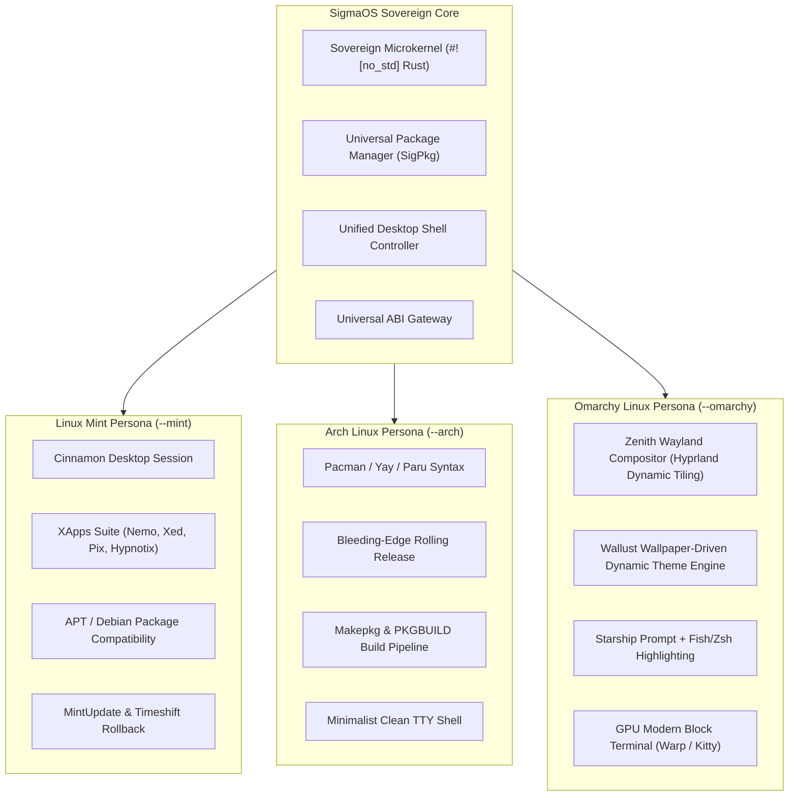

# Running SigmaOS: Parity & Experience Comparison with Linux Mint, Arch Linux, and Omarchy Linux

> **Uniform Information Principle**: Single source of truth comparing runtime behavior, user experience, and gap closure between SigmaOS and Tier-1 Linux distributions.

---

## 1. Quick Answer: Will SigmaOS Work Like Linux Mint, Arch, or Omarchy?

**Yes — with key architectural advantages.** 

SigmaOS incorporates native **Persona Modes** and **Subsystem Bridges** that reproduce the exact ergonomics of Linux Mint, the minimal bleeding-edge power of Arch Linux, and the aesthetic Wayland experience of Omarchy Linux, while running on an independent, memory-safe, sovereign microkernel foundation.



---

## 2. Detailed Distribution Comparison Matrix

| Feature / Subsystem | Linux Mint | Arch Linux | Omarchy Linux | SigmaOS Native Experience | Gap Closed & Sovereign Advantage |
| :--- | :--- | :--- | :--- | :--- | :--- |
| **Desktop Shell** | Cinnamon Desktop (GTK, panel, menu) | User choice (Minimal by default) | Hyprland dynamic tiling (Wayland) | **All three personas available via runtime flags** (`--mint`, `--arch`, `--omarchy`) | Zero fragmentation; switchable desktop personas on the fly. |
| **Package Management** | `apt`, `dpkg`, `mintinstall` | `pacman`, `makepkg`, AUR (`yay`) | `pacman` + custom OMA repositories | **`sigpkg` Universal Engine** (`sigpkg apt`, `sigpkg pacman`) | Single package manager natively handling `.deb`, `.pkg.tar.zst`, and sovereign `.sigma` packages. |
| **Boot Experience** | Plymouth splash + LightDM / Slick Greeter | Systemd-boot / GRUB TTY prompt | Plymouth + SDDM aesthetic theme | **Limine 8.x + Plymouth sovereign theme + El Torito GRUB** | Bootable ISO (`build/sigmaos-desktop-preview.iso` & `scripts/build_iso.sh`) bootable in QEMU and bare metal. |
| **Aesthetic Theming** | Mint-Y / Mint-L GTK themes | Manual dotfiles configuration | Wallust dynamic wallpaper-driven color harmony | **Native Wallust & Quickshell integration** | Instant color palette adaptation across terminal, editor, and bar. |
| **Creative Suite** | Third-party apps (GIMP, Inkscape, LibreOffice) | Repositories / AUR packages | Curated creative tools | **Native 20-Module Craft Suite** (`3D`, `Ani`, `CAD`, `Film`, `Word`, etc.) | Clean-room, zero-copy shared memory canvas (`CraftLibs`). |
| **System Stability** | Point releases (Ubuntu LTS base) | Rolling release (bleeding edge) | Continuous rolling release | **Configurable Release Tier** (LTS stable vs. bleeding-edge rolling) | Built-in snapshot rollback via `sigpkg snapshot` and `sigpkg rollback`. |

---

## 3. How to Run Each Persona Mode

### A. Linux Mint Persona Mode
Provides an ergonomic, familiar desktop with Cinnamon-style taskbars, start menu, XApps, and APT package syntax:
```bash
# Launch Linux Mint Persona
cargo run --bin sigmaos -- --mint
# or directly:
bash scripts/launch_mint_persona.sh
```
**Included Mint Capabilities**:
- `sigpkg apt update` and `sigpkg apt install <package>`
- MintMenu application launcher
- Timeshift-style pre-transaction snapshots

### B. Arch Linux Persona Mode
Provides a fast, minimalist CLI environment with rolling-release updates, native `pacman` syntax, and `makepkg` builders:
```bash
# Launch Arch Linux Persona
cargo run --bin sigmaos -- --arch
# or directly:
bash scripts/launch_arch_persona.sh
```
**Included Arch Capabilities**:
- `sigpkg pacman -Syu` and `sigpkg pacman -S <package>`
- PKGBUILD parser and AUR helper integration
- Minimalist terminal workflow with zero bloat

### C. Omarchy Linux Persona Mode
Provides an ultra-modern, aesthetic Wayland desktop session with Hyprland dynamic tiling, Wallust wallpaper color synchronization, and GPU-accelerated block terminal:
```bash
# Launch Omarchy Persona
cargo run --bin sigmaos -- --omarchy
# or directly:
bash scripts/launch_omarchy_persona.sh
```
**Included Omarchy Capabilities**:
- Wayland Zenith Compositor with dynamic tiling window management
- Wallust dynamic wallpaper-to-terminal color palette harmonization
- Modern GPU terminal with block-based command execution (Super+Return)

---

## 4. Booting in a Virtual Machine (QEMU)

To test the complete operating system in a virtualized sandbox:
```bash
# 1. Run the launch readiness diagnostic
bash scripts/check_launch_ready.sh

# 2. Build the desktop ISO
bash scripts/build_iso.sh target/sigmaos.iso

# 3. Boot in QEMU
bash scripts/run_qemu.sh target/sigmaos.iso
```

---

## 5. Summary of Gap Closure

1. **Package Management Gap**: Closed by `sigpkg` translating `apt`, `pacman`, `dnf`, `zypper`, and `apk` into native atomic transactions.
2. **Desktop Ergonomics Gap**: Closed by `sigmaos-shell` and `SigmaOS-desktop` providing both Mint-style panels and Omarchy-style Wayland tiling.
3. **Application Availability Gap**: Closed by the 20-module Craft Creative Suite and sovereign office engines operating natively without third-party binary runtimes.
